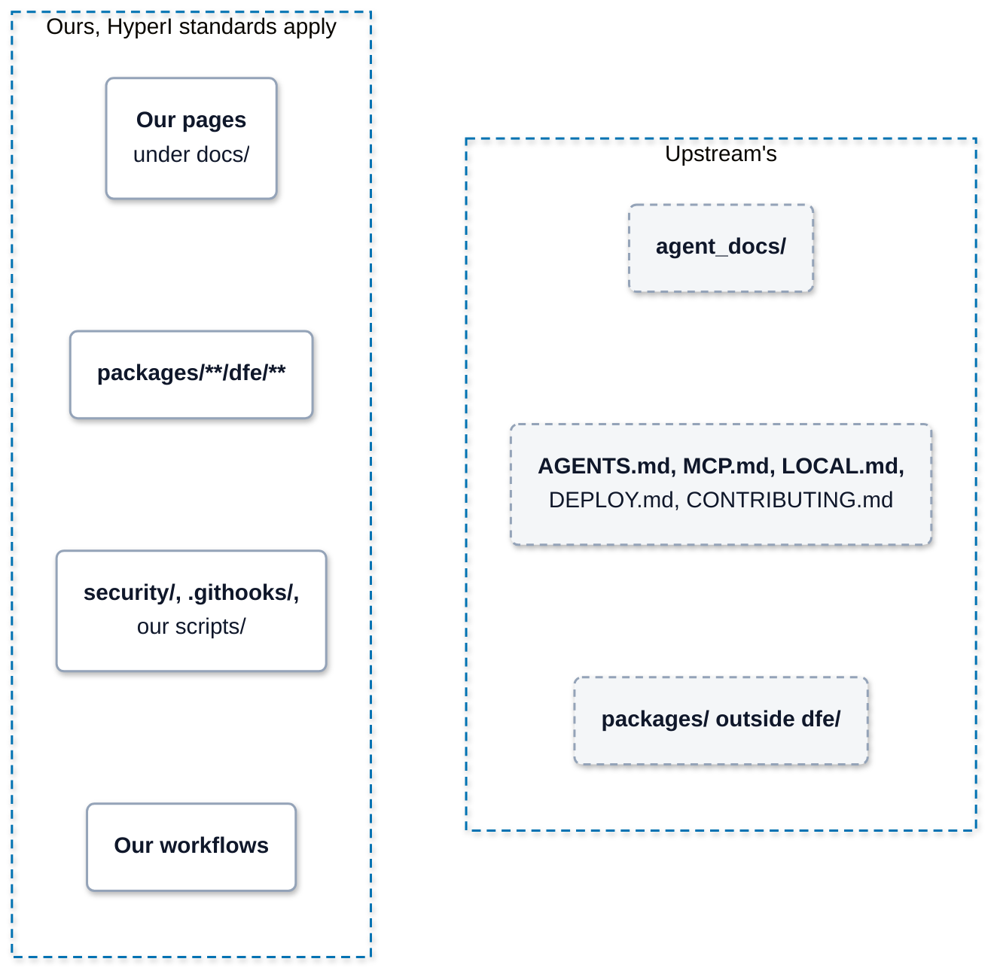

# dfe-hyperdx documentation

DFE's fork of [HyperDX](https://github.com/hyperdxio/hyperdx), embedded in the
DFE platform as its visualisation and search layer.

Four questions bring people here, and they are answered in different places:

| Question | Start at |
| --- | --- |
| **What does our fork do differently?** | [architecture.md](architecture.md) |
| **How do we maintain the fork?** | [fork/](fork/README.md) |
| How do I run it locally? | [development/](development/README.md) |
| Why was it built this way? | [decisions/](decisions/README.md) |

Which files are ours and which are upstream's matters more here than in a normal repo, because the answer decides whether
a change is free or expensive. Our files sit beside upstream's, and HyperI
standards apply to ours alone.



*Figure 1. L4 Detail -- Ours and upstream's files. Dashed boxes are upstream's.* Up: [dfe-hyperdx](../README.md).

Applying our conventions to `agent_docs/` or `AGENTS.md` would buy nothing and
create conflict surface on every sync. Where an upstream file does have a delta
of ours, `.fork-surface` lists it and [fork/what-we-changed.md](fork/what-we-changed.md)
says why. `README.md`, `CLAUDE.md` and `docs/alert-webhook-template-variables.md`
are the shared docs: upstream ships each, and each has a small delta of ours.

The documentation set:

```text
docs/
  architecture/    what the system is, and what DFE changes about it
  fork/            how the fork is held together and kept in sync
  development/     running it locally
  decisions/       ADRs - why we chose what we chose
```

Everything here is plain CommonMark plus fenced mermaid, so it renders on GitHub
without a build step.
