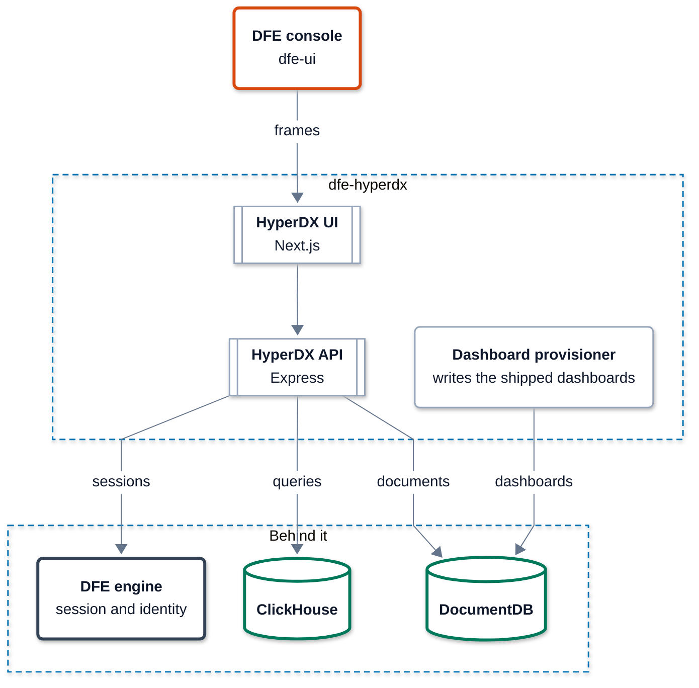

# dfe-hyperdx architecture

dfe-hyperdx is the search, charts and dashboards inside the DFE console, built
from a fork of HyperDX. The console frames it, the DFE engine signs every
session in, and it reads ClickHouse as the team's own user.

_Figure 1. L2 Services -- dfe-hyperdx._ Up: top of dfe-hyperdx. Down:
[L3 Components -- HyperDX UI](architecture/frontend.md),
[L3 Components -- HyperDX API](architecture/backend.md).

## How data flows

1. The **DFE console** frames the **HyperDX UI** in chromeless mode, and plants
   the engine token in the `dfe_token` cookie on the shared parent domain.
2. The **HyperDX UI** builds chart SQL in the browser and sends it through the
   API's ClickHouse proxy. Everything else goes through the API's REST routes.
3. The **HyperDX API** verifies the engine token itself and asks the **DFE
   engine** which team the session is on.
4. It queries **ClickHouse** as that team's own ClickHouse user, so ClickHouse
   GRANTs and row policies decide what it reads.
5. Saved searches, dashboards and alerts live in **DocumentDB**, scoped by team.
6. The **Dashboard provisioner** reads the dashboard content dfe-engine writes
   and syncs it into DocumentDB once a minute.

## Components

| Part                  | Role                                                                                                                                          | Page                                                                        |
| --------------------- | --------------------------------------------------------------------------------------------------------------------------------------------- | --------------------------------------------------------------------------- |
| HyperDX UI            | Search, charts and dashboards, framed by the console. Upstream's frontend, unchanged except for branding and our `dfe/` additions             | [architecture/frontend.md](architecture/frontend.md)                        |
| HyperDX API           | Upstream's Express API with our identity middleware, team seeding and request validation in `packages/api/src/dfe/`                           | [architecture/backend.md](architecture/backend.md)                          |
| Dashboard provisioner | A scheduled task in the API package (`tasks/provisionDashboards`) that writes the shipped dashboards. Our middleware locks them against edits | [fork/what-we-changed.md](fork/what-we-changed.md#dfe-integration-features) |

## External dependencies

| Dependency | Needed for                                                                          | Swappable                                                                                              |
| ---------- | ----------------------------------------------------------------------------------- | ------------------------------------------------------------------------------------------------------ |
| DFE engine | Every session, each team's ClickHouse connection, and the shipped dashboard content | No                                                                                                     |
| ClickHouse | Every query                                                                         | Any ClickHouse the engine names a connection for                                                       |
| DocumentDB | Users, teams, saved searches, dashboards and alerts                                 | Any MongoDB-wire store. DFE ships DocumentDB ([ADR 0006](decisions/0006-documentdb-document-store.md)) |

## Deployment variants

One image ships, `ghcr.io/hyperi-io/dfe-hyperdx`, and dfe-infra's chart deploys
it beside the rest of DFE. dfe-engine is the controlling repo for the HyperDX
integration.

- On Kubernetes the UI sits on its own subdomain, and the console reaches it
  through `HYPERDX_URL`.
- In the Docker compose stack it shares the console's host on another port,
  `HYPERDX_PORT` on the console side.
- For local development `yarn dev:dfe` runs the app and API from a checkout
  against DocumentDB in Docker
  ([development/getting-started.md](development/getting-started.md)).

## Design considerations

| Aspect      | How it is handled                                                                                                                                                                               |
| ----------- | ----------------------------------------------------------------------------------------------------------------------------------------------------------------------------------------------- |
| Security    | HyperDX's own password login is off. The API verifies the engine's ES384 token, and a team holds only its own ClickHouse connection. A team holding another ClickHouse user refuses the session |
| Reliability | Team seeding takes one claim per team, atomic across replicas, and retries once the 30-second claim lapses                                                                                      |
| Operations  | Health probes and `/metrics` mount before the identity middleware. A startup task deletes any connection that is not its team's own                                                             |

## Why it's built this way

| Decision                          | Reason                                                                                                                                                               |
| --------------------------------- | -------------------------------------------------------------------------------------------------------------------------------------------------------------------- |
| Authentication is the engine's    | The console signs the user in once, and every DFE surface trusts the same token                                                                                      |
| Authorization is the engine's too | The engine decides which ClickHouse user a session reads as, and ClickHouse GRANTs enforce it, so access is decided in one place                                     |
| DocumentDB, not MongoDB           | MongoDB's licence rules it out of DFE. DocumentDB speaks the same wire protocol, so HyperDX runs unchanged ([ADR 0006](decisions/0006-documentdb-document-store.md)) |
| Our code under `dfe/` directories | An upstream merge never conflicts there. Every in-place edit to an upstream file is listed in `.fork-surface` ([fork/design.md](fork/design.md))                     |
| JSON native throughout            | DFE tables use ClickHouse's JSON type, and the fork reads that type natively                                                                                         |

## Diagram map

- Figure 1. L2 Services -- dfe-hyperdx (this page)
  - [L3 Components -- HyperDX UI](architecture/frontend.md)
  - [L3 Components -- HyperDX API](architecture/backend.md)
    - [L4 Detail -- Authorization layers](architecture/authorization.md)
    - [L4 Detail -- Identity mode](architecture/oidc-authentication.md)
    - [L4 Detail -- Seeding a team connection](architecture/team-identity.md)
  - [L4 Detail -- Telemetry write path](architecture/data-flow.md)
  - [L4 Detail -- Sources and tables](architecture/clickhouse-data-model.md)
  - [L4 Detail -- Compose services](architecture/deployment.md)
- [L4 Detail -- Package dependencies](architecture/README.md)
- [The fork's diagrams](fork/README.md)

## What's next

- [Architecture pages](architecture/README.md): every page in this section, and
  where the code lives
- [The fork](fork/README.md): what we changed and how we keep it in step with
  upstream
- [Local development](development/README.md)
- [Decisions](decisions/README.md)
