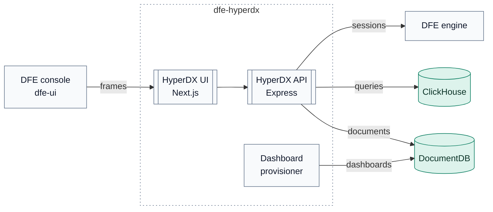
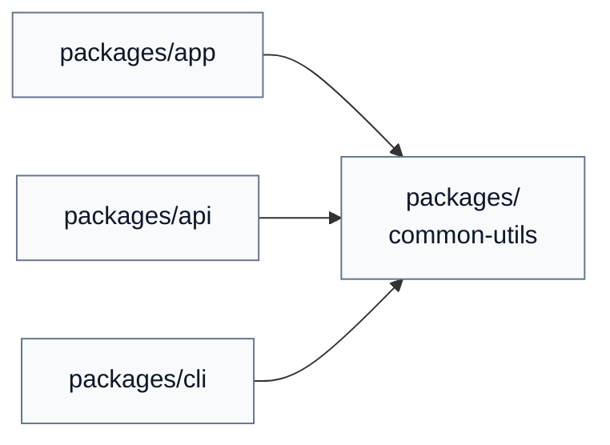

# Architecture

HyperDX is DFE's **visualisation and search layer**: engineers use it to search
logs, view traces and build dashboards, inside the DFE console. Detection,
alerting and response are the DFE platform's job, not HyperDX's.

Five things make our deployment different from stock HyperDX, and everything
else follows from them:

- Authentication is the engine's. The DFE console signs the user in through the
  DFE engine and hands the embedded app the engine's token in the `dfe_token`
  cookie. The API verifies that token itself, and HyperDX's own password login
  is switched off.
- Authorization is the engine's as well: it decides which ClickHouse user a
  session reads as, and ClickHouse GRANTs enforce data access.
- MongoDB is replaced by DocumentDB, PostgreSQL with the DocumentDB extensions
  and its Mongo wire-protocol gateway in one container
  ([ADR 0006](../decisions/0006-documentdb-document-store.md)).
- The DFE 2.1 discovery tool's enhancements are ported in, including turning the
  search in front of you into a DFE rule.
- JSON is native throughout, the ClickHouse JSON type included.

What we changed to achieve that, and how we keep it working across upstream
releases, is [the fork documentation](../fork/README.md).

---

## The system

The console frames the HyperDX UI, and the API behind it answers to the engine
for every session and reads ClickHouse as the team's own user.

*Figure 1. L2 Services -- dfe-hyperdx.* Up: top of dfe-hyperdx. Down: [L3 Components -- HyperDX UI](frontend.md#structure), [L3 Components -- HyperDX API](backend.md#structure).

One container runs the UI, the API and upstream's alert checker, and the dashboard provisioner when `DASHBOARD_PROVISIONER_DIR` is set. The engine calls the API as well, with
a service token of its own, to seed teams, sources and connections. No OTel
collector of HyperDX's runs in DFE: the DFE pipeline writes the telemetry
tables.

---

## Where things live

`app`, `api` and `cli` all build on `common-utils`, which holds the query
engine.

*Figure 2. L4 Detail -- Package dependencies.* Up: [L2 Services -- dfe-hyperdx](#the-system).

| Package                   | Role                                                           |
| ------------------------- | -------------------------------------------------------------- |
| `@hyperdx/app`            | Frontend: search, dashboards, session replay                   |
| `@hyperdx/api`            | REST API, OpAMP server, MCP server, ClickHouse proxy           |
| `@hyperdx/common-utils`   | Isomorphic query engine, Lucene-to-SQL parser, Zod types       |
| `@hyperdx/cli`            | Terminal CLI and TUI (`hdx`)                                   |
| `@hyperdx/otel-collector` | Custom OTel Collector build, plus ClickHouse schema migrations |
| `@hyperdx/hdx-eval`       | Benchmarks the MCP server against observability scenarios      |

Our additions live under `packages/api/src/dfe/**`, `packages/app/src/dfe/**`
and `packages/common-utils/src/dfe/**`, so they cannot collide with upstream.
Compose files and collector config are in `docker/`.

The rest of this section, page by page:

| Topic                                                          | Doc                                                    |
| -------------------------------------------------------------- | ------------------------------------------------------ |
| How telemetry gets from an SDK to a chart                      | [data-flow.md](data-flow.md)                           |
| How a search becomes SQL                                       | [clickhouse-data-model.md](clickhouse-data-model.md)   |
| Frontend structure and state                                   | [frontend.md](frontend.md)                             |
| API structure and the OpAMP and MCP servers                    | [backend.md](backend.md)                               |
| The engine token and how the API verifies it                   | [oidc-authentication.md](oidc-authentication.md)       |
| Who is allowed to see what                                     | [authorization.md](authorization.md)                   |
| Which team a user lands on, its connection, the startup repair | [team-identity.md](team-identity.md)                   |
| Turning a saved search into a DFE rule                         | [query-to-rule-pipeline.md](query-to-rule-pipeline.md) |
| DocumentDB, service topology                                   | [deployment.md](deployment.md)                         |
| Why we chose what we chose                                     | [../decisions/](../decisions/README.md)                |

These pages describe what the code does. Where a design has changed, the
superseded reasoning lives in [../decisions/](../decisions/README.md).
