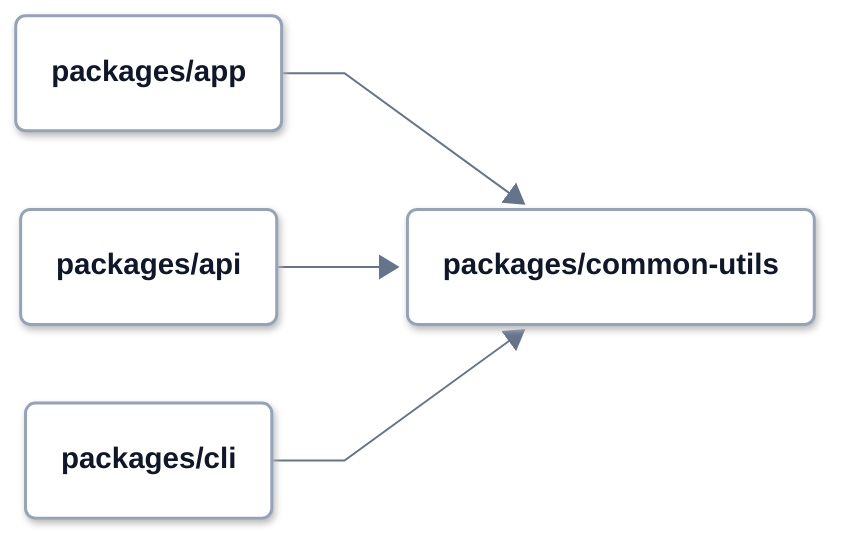

# Architecture pages

The [architecture page](../architecture.md) has the parts and why it is built this way. These pages go one level down, and this one says where the code lives.

## Where things live

`app`, `api` and `cli` all build on `common-utils`, which holds the query
engine.

*Figure 1. L4 Detail -- Package dependencies.* Up: [L2 Services -- dfe-hyperdx](../architecture.md).

| Package                   | Role                                                           |
| ------------------------- | -------------------------------------------------------------- |
| `@hyperdx/app`            | Frontend: search, dashboards, session replay                   |
| `@hyperdx/api`            | REST API, OpAMP server, MCP server, ClickHouse proxy           |
| `@hyperdx/common-utils`   | Isomorphic query engine, Lucene-to-SQL parser, Zod types       |
| `@hyperdx/cli`            | Terminal CLI and TUI (`hdx`)                                   |
| `@hyperdx/otel-collector` | Custom OTel Collector build, plus ClickHouse schema migrations |
| `@hyperdx/hdx-eval`       | Benchmarks the MCP server against observability scenarios      |

Our additions live under `packages/api/src/dfe/**`, `packages/app/src/dfe/**`
and `packages/common-utils/src/dfe/**`, so they cannot collide with upstream.
Compose files and collector config are in `docker/`.

The rest of this section, page by page:

| Topic                                                          | Doc                                                    |
| -------------------------------------------------------------- | ------------------------------------------------------ |
| How telemetry gets from an SDK to a chart                      | [data-flow.md](data-flow.md)                           |
| How a search becomes SQL                                       | [clickhouse-data-model.md](clickhouse-data-model.md)   |
| Frontend structure and state                                   | [frontend.md](frontend.md)                             |
| API structure and the OpAMP and MCP servers                    | [backend.md](backend.md)                               |
| The engine token and how the API verifies it                   | [oidc-authentication.md](oidc-authentication.md)       |
| Who is allowed to see what                                     | [authorization.md](authorization.md)                   |
| Which team a user lands on, its connection, the startup repair | [team-identity.md](team-identity.md)                   |
| Turning a saved search into a DFE rule                         | [query-to-rule-pipeline.md](query-to-rule-pipeline.md) |
| DocumentDB, service topology                                   | [deployment.md](deployment.md)                         |
| Why we chose what we chose                                     | [../decisions/](../decisions/README.md)                |

These pages describe what the code does. Where a design has changed, the
superseded reasoning lives in [../decisions/](../decisions/README.md).
