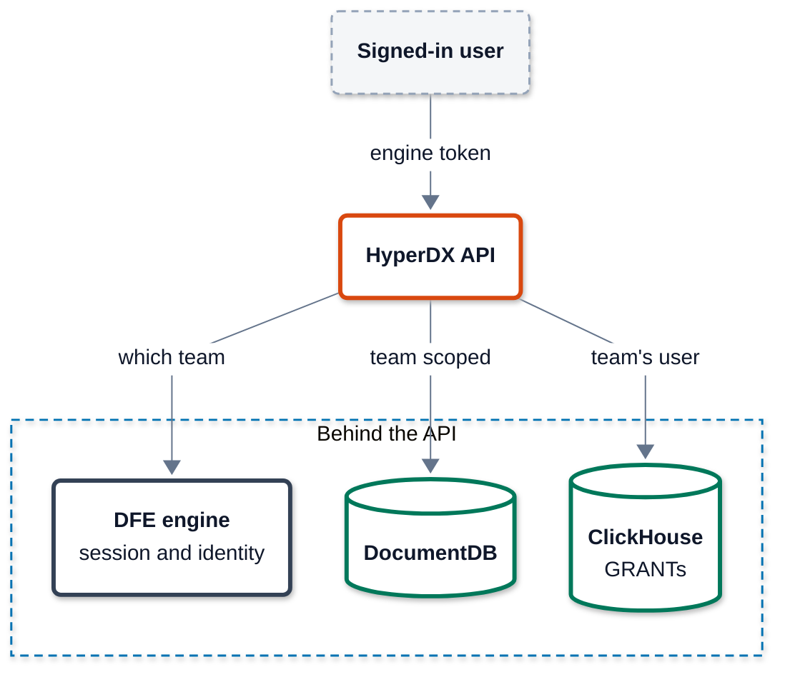

# Authorization

**The DFE engine decides, ClickHouse enforces, HyperDX scopes by team.**

HyperDX holds no policy store of its own in this fork. Casbin RBAC was removed
as redundant, see [ADR 0004](../decisions/0004-casbin-removed.md) for why.

---

## Who decides what

The engine names the session's team, the API scopes every document by that team,
and ClickHouse holds the team's user to its GRANTs.

_Figure 1. L4 Detail -- Authorization layers. The dashed box is outside
dfe-hyperdx._ Up: [L3 Components -- HyperDX API](backend.md#structure).

Three layers, each doing one thing:

1. The engine says who the user is and which ClickHouse user the session reads
   as. dfe-hyperdx verifies the engine's token and asks the engine about every
   session. See [oidc-authentication.md](oidc-authentication.md).
2. HyperDX maps that identity to a User and a Team, then scopes every query by
   `team`. Every route handler does this, which is why Casbin was redundant, and
   the fork corrects `getTeam(id)` to filter by that id. Our admin lockdown on
   top refuses human writes to teams, sources and connections, and every human
   request to alerts and webhooks.
3. ClickHouse enforces data access with GRANTs. Each Team's `Connection` record
   holds that team's ClickHouse username and password, so a query that escaped
   the application-level scoping still cannot read another team's data.

The engine is the policy decision point for the wider platform. HyperDX consults
it per session, cached for 30 seconds, and the decision is expressed as which
ClickHouse user a Team's connection holds
([team-identity.md](team-identity.md)).

Application-level scoping is a correctness property of upstream's code, and
upstream can change it. Data-layer GRANTs are ours, and they hold regardless.

That is the useful division. We do not re-implement upstream's tenancy inside
their code, which would be conflict surface to defend on every sync. We put our
enforcement where upstream cannot reach.

A route under `packages/api/src/dfe/` inherits nothing automatically. Scope your
query by `req.user.team` the way upstream's handlers do, and assume the
ClickHouse credentials in play are the right ones for that team.
