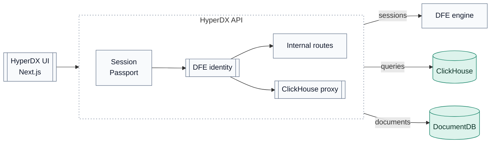
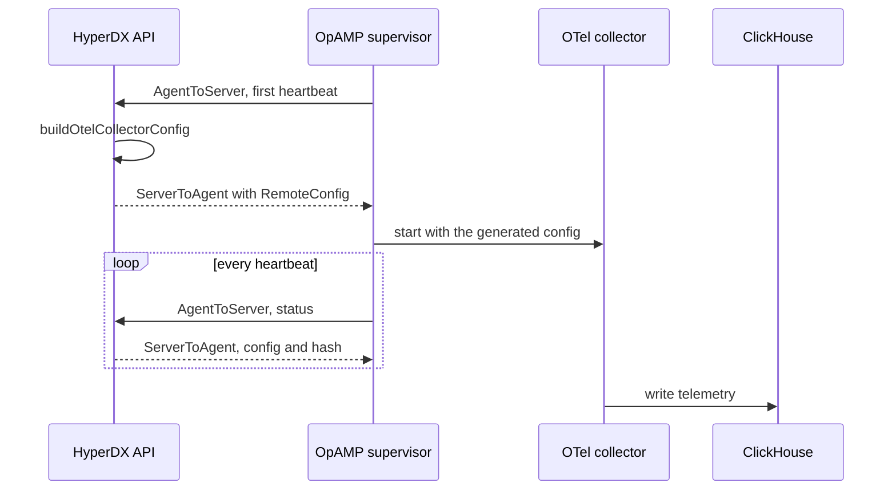

# Backend

> **Scope.** This describes UPSTREAM HyperDX's API, which we do not modify, and
> where our `dfe/` layer sits in it. It is here so the fork's own docs are
> readable on their own. Upstream's [`agent_docs/`](../../agent_docs/) is the
> authority for upstream's parts.

## Structure

With DFE auth on, application routes run after upstream's session middleware and
our identity middleware. Health probes and `/metrics` mount before both.

_Figure 1. L3 Components -- HyperDX API._ Up:
[L2 Services -- dfe-hyperdx](README.md#the-system). Down:
[L4 Detail -- Engine token check](oidc-authentication.md#the-flow),
[L4 Detail -- Query read path](data-flow.md#read-path).

| Part             | What it is                                                                                                                                             |
| ---------------- | ------------------------------------------------------------------------------------------------------------------------------------------------------ |
| Session          | Upstream's Passport.js session auth (`passport-local-mongoose`), sessions stored through `connect-mongo`. Bypassed in local mode (`IS_LOCAL_APP_MODE`) |
| DFE identity     | Ours, `dfe/middleware/jwt-verify.ts`. Verifies the engine token and signs the user in, see [oidc-authentication.md](oidc-authentication.md)            |
| Internal routes  | `/dashboards`, `/saved-search`, `/sources`, `/connections`, `/team`, `/me`, `/ai` and the rest, plus our `/dfe` routes                                 |
| ClickHouse proxy | `/clickhouse-proxy`, which sends the browser's SQL to ClickHouse with the team connection's credentials                                                |
| External API     | `/api/v2/*`, Bearer auth on the user's `accessKey`, rate limited per key (`EXTERNAL_API_RATE_LIMIT_MAX` a minute). Engine-only in DFE mode             |
| OpAMP server     | A separate port that serves collector configuration, below                                                                                             |

In DFE mode `/alerts`, `/webhooks`, `/api/v2`, `/mcp` and personal access keys
refuse every human session, and `/connections`, `/sources` and `/team` let a
member read but not write. The engine's service token reaches team, source and
connection routes alone. The list is in
[what-we-changed.md](../fork/what-we-changed.md#authorization).

## OTel collector and OpAMP

Upstream's collector takes its receivers, connectors, exporters and pipeline
wiring from the API over OpAMP. DFE runs no such collector: the DFE pipeline
writes the telemetry tables, so this path is idle in a DFE deployment.

_Figure 2. L4 Detail -- OpAMP collector configuration. Dashed arrows are
answers._ Up: [L3 Components -- HyperDX API](#structure).

The remote configuration covers receivers, connectors, exporters and pipeline
wiring, built from team settings. Processors and each pipeline's processor list
come from the bootstrap `docker/otel-collector/config.yaml` and an optional
custom file. That gives pipeline changes without a collector restart, API-key
enforcement when a team turns on `collectorAuthenticationEnforced`, and the
routing connector that sends rrweb events to their own pipeline and table. With
no `OPAMP_SERVER_URL` the collector runs standalone on
`docker/otel-collector/config.yaml` plus a standalone config file.

## Features

Browser SDKs capture DOM mutations as **rrweb** events, shipped as OTLP logs
with a `rr-web.event` attribute. The collector routes these to
`hyperdx_sessions`. The frontend reconstructs playback using rrweb's `Replayer`
class, correlated to logs and traces via `rum.sessionId`. The DFE console does
not offer session replay: the embed blocks `/sessions`.

A dashboard is a document in DocumentDB holding a set of **tiles**, each a
`SavedChartConfig` (source, display type, select, where, groupBy).
Dashboard-level filters apply across all tiles, and import and export use
versioned JSON templates. A saved search is a query against one Source, with a
Lucene or SQL `where`, kept in DocumentDB and listed in the sidebar by tag.

The AI assistant uses the Vercel AI SDK with Anthropic or OpenAI as the provider
(`AI_PROVIDER`). The backend introspects ClickHouse table metadata for schema
context, then returns chart, search and table configurations the frontend
renders directly.
