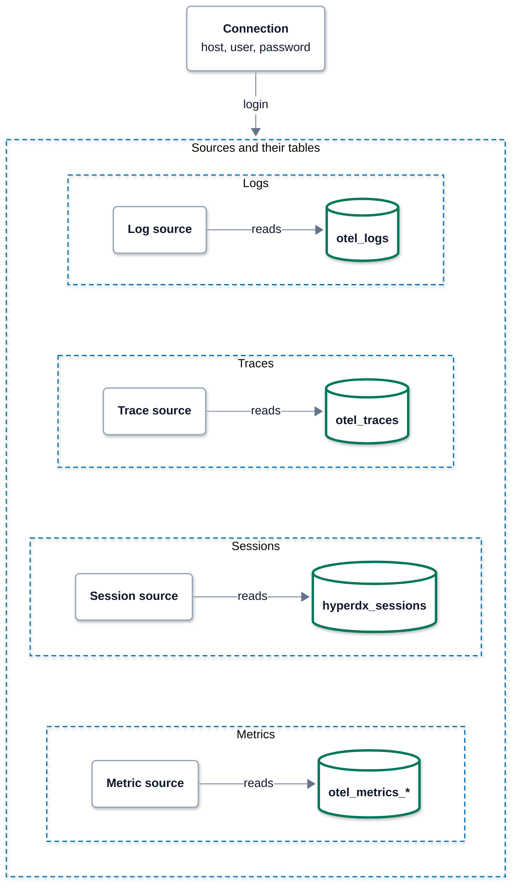
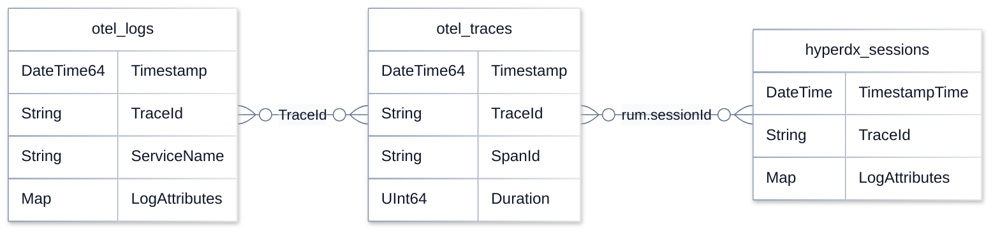

# ClickHouse data model

> **Scope.** This describes UPSTREAM HyperDX's architecture, which we do not
> modify. It is here so the fork's own docs are readable on their own.
> Upstream's [`agent_docs/`](../../agent_docs/) is the authority, and anything
> specific to DFE is called out as such.

HyperDX is not tied to any table schema. The **Source** model maps ClickHouse
table columns to semantic roles through SQL expressions. A connection holds the
ClickHouse login, and each source points one kind of telemetry at one table
through that connection.

_Figure 1. L4 Detail -- Sources and tables._ Up: [Architecture](README.md).

A source's expression fields map semantic concepts to SQL over its table:
`timestampValueExpression`, `bodyExpression`, `severityTextExpression`,
`traceIdExpression`, `spanIdExpression`, `serviceNameExpression` and many more.
Sources cross-reference each other (`logSourceId`, `traceSourceId`,
`sessionSourceId`, `metricSourceId`), which is how the UI moves between
telemetry types. So HyperDX can work on top of any ClickHouse table: point it at
your schema and map the columns.

In DFE the engine owns sources. A team is seeded with `main` and `hunts`, and
the platform team with the OTel tables and ClickHouse's `system` database as
well
([what-we-changed.md](../fork/what-we-changed.md#dfe-integration-features)).

## Tables

Logs and traces join on `TraceId`, and traces join a browser session through the
`rum.sessionId` attribute.

_Figure 2. L4 Detail -- Upstream telemetry tables. Key columns only._ Up:
[Architecture](README.md).

The schema is in `docker/otel-collector/schema/seed/`. The telemetry tables are
MergeTree with ZSTD codecs, partitioned by day and expired by a TTL on their
timestamp. Rollups are SummingMergeTree, and `00008_otel_metrics_timeseries.sql`
adds a TimeSeries table. The primary `otel_logs` and `otel_traces` schemas use
`text` indexes on attribute maps, trace ids and the body or span name. The
`_compat` schemas and `hyperdx_sessions` use bloom filter and `tokenbf_v1`
indexes. Kubernetes resource attributes, and `rum.sessionId` on traces, are
materialised columns. The metrics land in five tables, `otel_metrics_gauge`,
`_sum`, `_histogram`, `_exponential_histogram` and `_summary`.
