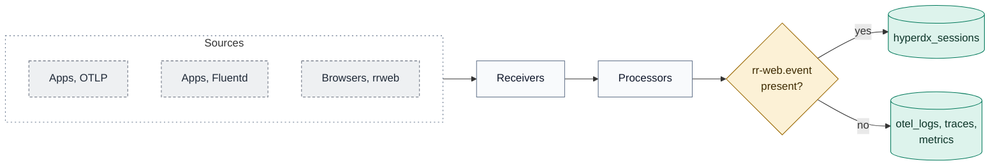
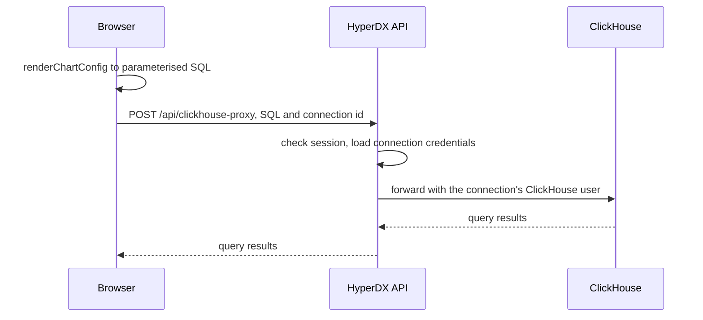
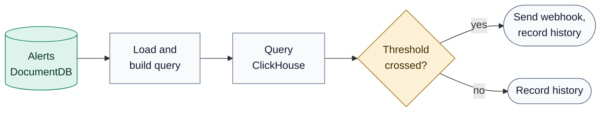

# Data flow

> **Scope.** This describes UPSTREAM HyperDX's architecture, which we do not
> modify. It is here so the fork's own docs are readable on their own.
> Upstream's [`agent_docs/`](../../agent_docs/) is the authority, and anything
> specific to DFE is called out as such.

## Write path

Upstream's collector takes OTLP and Fluentd input, and its routing connector
sends rrweb events to their own table and everything else to the OTel tables.

<!-- prettier-ignore -->
*Figure 1. L4 Detail -- Telemetry write path. Dashed boxes are external.* Up: [Architecture](README.md).

- Receivers accept OTLP (gRPC on 4317, HTTP on 4318) and Fluentd (24225).
- The transform processor parses JSON log bodies, infers severity and normalises
  case. Batch and memory limiter processors follow.
- The routing connector checks the `rr-web.event` log attribute.
- The ClickHouse exporter writes `otel_logs`, `otel_traces` and five metric
  tables over the native protocol.

DFE runs none of this. The DFE pipeline writes the telemetry tables, and no
OpAMP-managed collector of HyperDX's is deployed.

## Read path

The browser renders the SQL, and the API adds the team connection's credentials
on the way to ClickHouse.

<!-- prettier-ignore -->
*Figure 2. L4 Detail -- Query read path. Dashed arrows are answers.* Up: [L3 Components -- HyperDX API](backend.md#structure).

The query engine (`renderChartConfig` in `common-utils`) runs **in the
browser**, generating parameterised ClickHouse SQL. The API is an authenticated
proxy: it never interprets the SQL, it checks the session and sets
`X-ClickHouse-User` and `X-ClickHouse-Key` from the connection. In DFE mode it
first drops every credential the caller sent (`dropClientCredentials`).

In **local mode** (`IS_LOCAL_MODE`, a single-user deployment), the browser
queries ClickHouse directly, bypassing the proxy.

## Alert evaluation

The alert checker task starts with the image in DFE as well, but nobody can
create an alert for it to evaluate. In DFE mode `/alerts` and `/webhooks` refuse
every human session, the engine's service token reaches team, source and
connection routes alone, and the console sends a visit to `/alerts` back to
`/search`. Detection and alerting are the DFE rules engine's and its hunts,
which query ClickHouse directly
([ADR 0002](../decisions/0002-alerting-disabled-for-dfe-rules.md)). The flow
below is upstream's, for reference.

<!-- prettier-ignore -->
*Figure 3. L4 Detail -- Upstream alert evaluation.* Up: [Architecture](README.md).

The checker runs once a minute. Each alert references a saved search or a
dashboard tile, from which a `ChartConfig` is derived and evaluated against
ClickHouse. Webhook bodies are templates with the alert's context.
