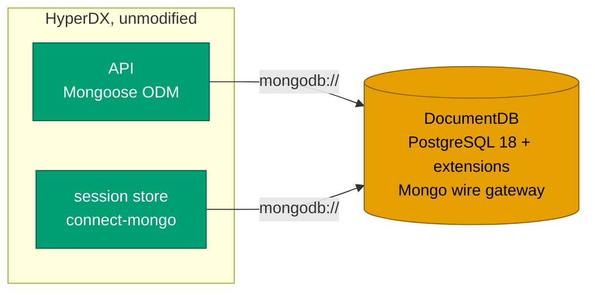
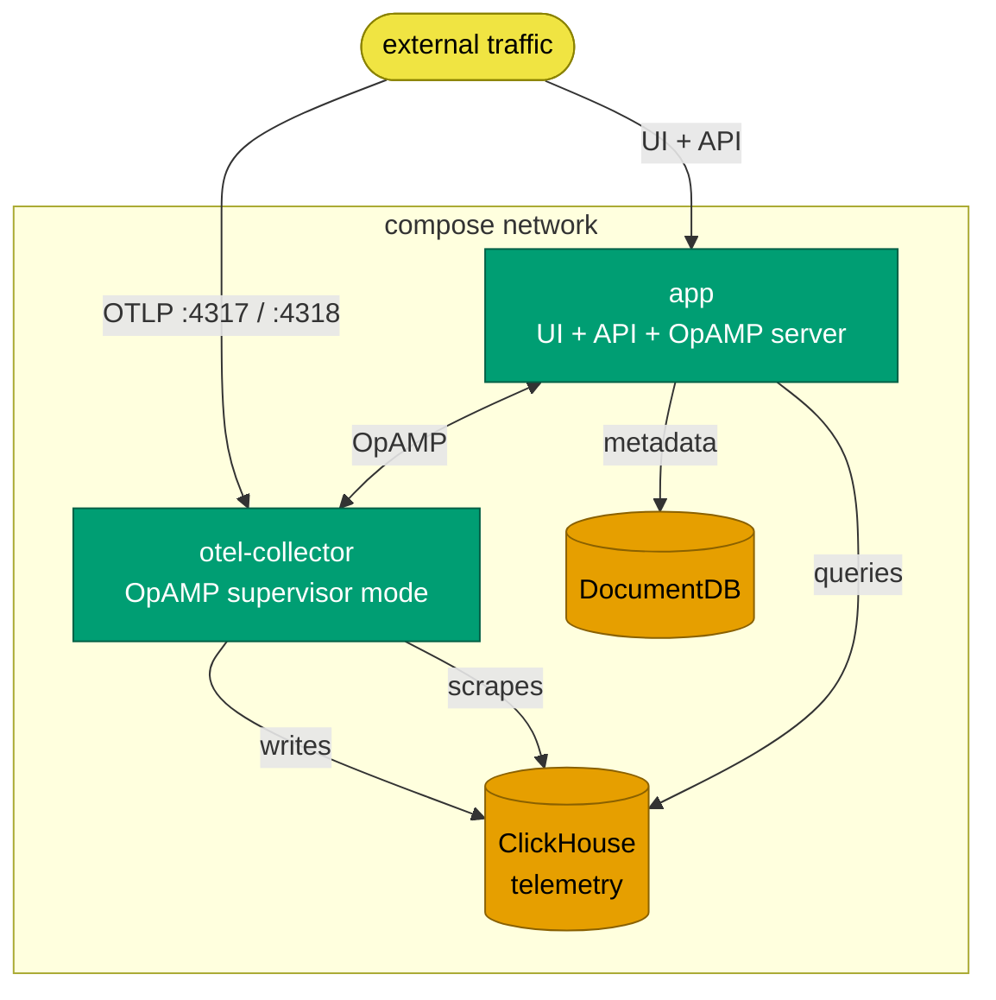

# Deployment

**The document store is DocumentDB, and HyperDX does not know.** Mongoose,
`connect-mongo`, `passport-local-mongoose`, `migrate-mongo` and every model and
route work unchanged - `MONGO_URI` points at the DocumentDB gateway.

---

## The data layer

The gateway speaks the MongoDB wire protocol, so standard drivers and tools
(`mongosh`, Compass, `mongodump`) connect with an ordinary `mongodb://` string.
Documents land in PostgreSQL as BSON via the DocumentDB extensions, which brings
PostgreSQL's backup, replication and monitoring ecosystem to the data. On
Kubernetes the DocumentDB operator runs the cluster on CloudNativePG (dfe-infra
`helm/charts/documentdb`).

---

## Running it

The override is `docker-compose.dfe.yml`, which replaces the `db` service and
repoints the app. **Read that file for the current values** - reproducing them
here just creates a second copy to go stale.

Two things about it are worth knowing, because they are easy to get wrong:

- **TLS and SCRAM-SHA-256.** The gateway refuses plain connections. `MONGO_URI`
  sets `tls=true`, a `tlsCAFile` for the CA that the `documentdb-tls` service
  mints, and `authMechanism=SCRAM-SHA-256`.
- **The gateway listens on 10260 in the container.** Compose reaches it at
  `documentdb:10260`, and the dev override publishes it as 27017.

Credentials come from the environment (`POSTGRES_USER`, `POSTGRES_PASSWORD`),
not from literals in the compose file.

---

## Service topology

The `app` container bundles the Next.js frontend and the Express API. The
collector runs in **OpAMP supervisor mode** - it takes its pipeline
configuration from the API at runtime rather than from a static file, which is
why the API is both a query server and a control plane.

Image tags and ports live in the compose files; see
[../development/docker-local.md](../development/docker-local.md) for running it
locally.

---

## What DFE adds on top

In the DFE platform this sits behind Envoy, which terminates OIDC - see
[oidc-authentication.md](oidc-authentication.md). Alerting is not started; the
DFE rules engine owns detection
([ADR 0002](../decisions/0002-alerting-disabled-for-dfe-rules.md)).
