# Deployment

**The document store is DocumentDB, and HyperDX does not know.** Mongoose,
`connect-mongo`, `passport-local-mongoose`, `migrate-mongo` and every model and
route work unchanged: `MONGO_URI` points at the DocumentDB gateway.

---

## The data layer

The API's models and its session store both reach DocumentDB over an ordinary
`mongodb://` connection.

```mermaid
---
config:
  theme: base
  look: neo
  fontFamily: Inter, -apple-system, Segoe UI, Roboto, Helvetica, Arial, sans-serif
  flowchart:
    curve: linear
    nodeSpacing: 40
    rankSpacing: 64
    padding: 18
    wrappingWidth: 280
    htmlLabels: true
  elk:
    preset: modelOrder
  themeVariables:
    fontSize: 15px
    lineColor: "#64748B"
    primaryTextColor: "#0F172A"
    clusterBorder: "#0072B2"
    edgeLabelBackground: "#FFFFFF"
  themeCSS: >-
    p{margin:0}
    .node[data-look] rect,.node[data-look] path,.node[data-look] polygon,.node[data-look] .outer-path{filter:drop-shadow(0 1px 2px rgba(15,23,42,.10)) drop-shadow(0 6px 14px rgba(15,23,42,.10))}
    .node rect{rx:10px;ry:10px}
    .cluster rect{rx:16px;ry:16px}
    .node .label div{min-width:150px}
    .node.decision .label div{min-width:0}
    .cluster[data-look] rect{filter:none}
    .nodeLabel{line-height:1.35}
    .nodeLabel b{font-weight:600;font-size:15px;letter-spacing:-0.01em}
    .nodeLabel span{font-size:12.5px;font-weight:400;color:#334155}
    .cluster-label span.nodeLabel{display:inline-block;background:#FFFFFF;color:#0B2A3F;border:1.5px solid #0072B2;border-radius:999px;padding:2px 12px;font-size:11.5px;font-weight:700;letter-spacing:.09em;text-transform:uppercase}
    .flowchart-link{stroke-width:1.75px}
    .labelBkg{background:transparent!important}
    span.edgeLabel{display:inline-block;background:#FFFFFF!important;color:#1E293B;border:1px solid #94A3B8;border-radius:999px;padding:2px 10px;font-size:12px;font-weight:500}
    span.edgeLabel p{background:transparent!important}
    .label-icon{width:20px;height:20px;vertical-align:-4px;margin-right:6px}
    .ingest .label-icon{color:#0E8A7D}
    .xform .label-icon{color:#7B4FB0}
    .load .label-icon{color:#0072B2}
    .bus .label-icon{color:#A8517F}
    .store .label-icon{color:#00785A}
    .ui .label-icon{color:#D9480F}
    .ext .label-icon{color:#64748B}
---
flowchart LR
  accTitle: L4 Detail -- Document store
  accDescr: The unmodified HyperDX API models and the connect-mongo session store connect to DocumentDB through its Mongo wire-protocol gateway.
  subgraph app["HyperDX, unmodified"]
    models("<b>API models</b><br/><span>Mongoose</span>")
    sessions("<b>Session store</b><br/><span>connect-mongo</span>")
  end
  docdb[("<b>DocumentDB</b><br/><span>PostgreSQL 18</span>")]
  app -->|mongodb://| docdb
  classDef ext fill:#F4F6F8,stroke:#94A3B8,stroke-width:1.5px,stroke-dasharray:5 4,color:#0F172A
  classDef ingest fill:#FFFFFF,stroke:#0E8A7D,stroke-width:3px,color:#0F172A
  classDef xform fill:#FFFFFF,stroke:#7B4FB0,stroke-width:3px,color:#0F172A
  classDef load fill:#FFFFFF,stroke:#0072B2,stroke-width:3px,color:#0F172A
  classDef bus fill:#FFFFFF,stroke:#A8517F,stroke-width:3px,color:#0F172A
  classDef store fill:#FFFFFF,stroke:#00785A,stroke-width:3px,color:#0F172A
  classDef ui fill:#FFFFFF,stroke:#D9480F,stroke-width:3px,color:#0F172A
  classDef decision fill:#FFFFFF,stroke:#9A6700,stroke-width:3px,color:#0F172A
  classDef error fill:#FFFFFF,stroke:#C2410C,stroke-width:3px,color:#0F172A
  classDef control fill:#FFFFFF,stroke:#334155,stroke-width:3px,color:#0F172A
  classDef part fill:#FFFFFF,stroke:#94A3B8,stroke-width:1.5px,color:#0F172A
  class models,sessions part
  class docdb store
  style app fill:none,stroke:#0072B2,stroke-width:1.5px,stroke-dasharray:6 4
```

_Figure 1. L4 Detail -- Document store._ Up:
[L3 Components -- HyperDX API](backend.md#structure).

The gateway speaks the MongoDB wire protocol, so standard drivers and tools
(`mongosh`, Compass, `mongodump`) connect with an ordinary `mongodb://` string.
Documents land in PostgreSQL as BSON through the DocumentDB extensions, which
brings PostgreSQL's backup, replication and monitoring to the data. On
Kubernetes the DocumentDB operator runs the cluster on CloudNativePG (dfe-infra
`helm/charts/documentdb`).

In compose, the override is `docker-compose.dfe.yml`, which replaces the `db`
service and repoints the app. **Read that file for the values**: reproducing
them here makes a second copy to go stale.

Two things about it are easy to get wrong:

- TLS and SCRAM-SHA-256. The gateway rejects plain connections. `MONGO_URI` sets
  `tls=true`, a `tlsCAFile` for the CA that the `documentdb-tls` service mints,
  and `authMechanism=SCRAM-SHA-256`.
- The gateway listens on 10260 in the container. Compose reaches it at
  `documentdb:10260`, and the dev override publishes it as 27017.

Credentials come from the environment (`POSTGRES_USER`, `POSTGRES_PASSWORD`),
not from literals in the compose file.

---

## Service topology

In the compose stack, applications send telemetry to the collector and users
reach the app, and both write to or read ClickHouse.

```mermaid
---
config:
  theme: base
  look: neo
  fontFamily: Inter, -apple-system, Segoe UI, Roboto, Helvetica, Arial, sans-serif
  flowchart:
    curve: linear
    nodeSpacing: 40
    rankSpacing: 64
    padding: 18
    wrappingWidth: 280
    htmlLabels: true
  elk:
    preset: modelOrder
  themeVariables:
    fontSize: 15px
    lineColor: "#64748B"
    primaryTextColor: "#0F172A"
    clusterBorder: "#0072B2"
    edgeLabelBackground: "#FFFFFF"
  themeCSS: >-
    p{margin:0}
    .node[data-look] rect,.node[data-look] path,.node[data-look] polygon,.node[data-look] .outer-path{filter:drop-shadow(0 1px 2px rgba(15,23,42,.10)) drop-shadow(0 6px 14px rgba(15,23,42,.10))}
    .node rect{rx:10px;ry:10px}
    .cluster rect{rx:16px;ry:16px}
    .node .label div{min-width:150px}
    .node.decision .label div{min-width:0}
    .cluster[data-look] rect{filter:none}
    .nodeLabel{line-height:1.35}
    .nodeLabel b{font-weight:600;font-size:15px;letter-spacing:-0.01em}
    .nodeLabel span{font-size:12.5px;font-weight:400;color:#334155}
    .cluster-label span.nodeLabel{display:inline-block;background:#FFFFFF;color:#0B2A3F;border:1.5px solid #0072B2;border-radius:999px;padding:2px 12px;font-size:11.5px;font-weight:700;letter-spacing:.09em;text-transform:uppercase}
    .flowchart-link{stroke-width:1.75px}
    .labelBkg{background:transparent!important}
    span.edgeLabel{display:inline-block;background:#FFFFFF!important;color:#1E293B;border:1px solid #94A3B8;border-radius:999px;padding:2px 10px;font-size:12px;font-weight:500}
    span.edgeLabel p{background:transparent!important}
    .label-icon{width:20px;height:20px;vertical-align:-4px;margin-right:6px}
    .ingest .label-icon{color:#0E8A7D}
    .xform .label-icon{color:#7B4FB0}
    .load .label-icon{color:#0072B2}
    .bus .label-icon{color:#A8517F}
    .store .label-icon{color:#00785A}
    .ui .label-icon{color:#D9480F}
    .ext .label-icon{color:#64748B}
---
flowchart LR
  accTitle: L4 Detail -- Compose services
  accDescr: Instrumented applications send OTLP to the otel-collector, which writes ClickHouse. Users reach the app container, which queries ClickHouse and keeps its documents in DocumentDB.
  senders("<b>Instrumented applications</b>")
  users("<b>Users</b>")
  otel("<b>otel-collector</b>")
  app("<b>app</b><br/><span>UI, API, OpAMP</span>")
  ch[("<b>ClickHouse</b>")]
  docdb[("<b>DocumentDB</b>")]
  senders -->|OTLP| otel
  users -->|UI and API| app
  otel -->|writes| ch
  app -->|queries| ch
  app -->|documents| docdb
  classDef ext fill:#F4F6F8,stroke:#94A3B8,stroke-width:1.5px,stroke-dasharray:5 4,color:#0F172A
  classDef ingest fill:#FFFFFF,stroke:#0E8A7D,stroke-width:3px,color:#0F172A
  classDef xform fill:#FFFFFF,stroke:#7B4FB0,stroke-width:3px,color:#0F172A
  classDef load fill:#FFFFFF,stroke:#0072B2,stroke-width:3px,color:#0F172A
  classDef bus fill:#FFFFFF,stroke:#A8517F,stroke-width:3px,color:#0F172A
  classDef store fill:#FFFFFF,stroke:#00785A,stroke-width:3px,color:#0F172A
  classDef ui fill:#FFFFFF,stroke:#D9480F,stroke-width:3px,color:#0F172A
  classDef decision fill:#FFFFFF,stroke:#9A6700,stroke-width:3px,color:#0F172A
  classDef error fill:#FFFFFF,stroke:#C2410C,stroke-width:3px,color:#0F172A
  classDef control fill:#FFFFFF,stroke:#334155,stroke-width:3px,color:#0F172A
  classDef part fill:#FFFFFF,stroke:#94A3B8,stroke-width:1.5px,color:#0F172A
  class senders,users ext
  class otel part
  class app ui
  class ch,docdb store
```

_Figure 2. L4 Detail -- Compose services. Dashed boxes are external._ Up:
[Architecture](README.md).

The `app` container bundles the Next.js frontend and the Express API. The
collector runs in **OpAMP supervisor mode**: it takes its pipeline from the
API's OpAMP server at runtime rather than from a static file, which is why the
API is both a query server and a control plane. It scrapes ClickHouse's
Prometheus metrics as well as writing telemetry. Image tags and ports live in
the compose files, and
[../development/docker-local.md](../development/docker-local.md) covers running
it locally.

In the DFE platform the console frames the app and the API verifies the engine's
token, see [oidc-authentication.md](oidc-authentication.md). The DFE pipeline
writes the telemetry, so no collector of HyperDX's runs there. Alerting stays
upstream's code with nobody able to create an alert
([ADR 0002](../decisions/0002-alerting-disabled-for-dfe-rules.md)).
