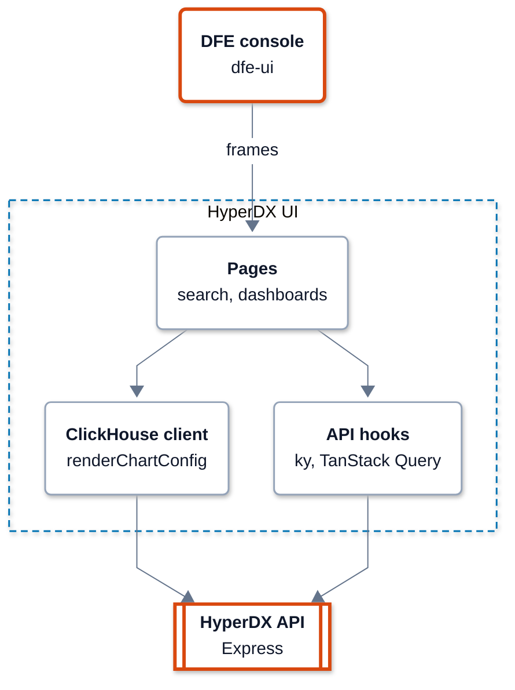

# HyperDX UI

The HyperDX UI is the search, charts and dashboards the DFE console frames, and
is one part of [dfe-hyperdx](../architecture.md).

| Fact      | Value                                                                                |
| --------- | ------------------------------------------------------------------------------------ |
| Repo      | `hyperi-io/dfe-hyperdx`, `packages/app`, our additions under `packages/app/src/dfe/` |
| Image     | `ghcr.io/hyperi-io/dfe-hyperdx`, deployed by dfe-infra's chart                       |
| Config    | `HYPERDX_APP_PORT`, 8080 by default                                                  |
| Endpoints | the Next.js pages on port 8080, framed by the console with `?embed=1`                |
| Metrics   | none of its own                                                                      |

Charts build their SQL in the browser and send it through the API's ClickHouse
proxy, and everything else goes through the API's REST routes.

_Figure 1. L3 Components -- HyperDX UI._ Up:
[L2 Services -- dfe-hyperdx](../architecture.md).

> **Scope.** This describes UPSTREAM HyperDX's frontend, which we do not modify,
> as the DFE console frames it. It is here so the fork's own docs are readable
> on their own. Upstream's [`agent_docs/`](../../agent_docs/) is the authority,
> and anything specific to DFE is called out as such.

## Structure

The DFE embed turns on four features, search, saved searches, the chart explorer
and dashboards (`packages/app/src/dfe/embedFeatures.ts`). A direct visit to
`/alerts`, `/sessions`, `/service-map` or `/team` is sent back to `/search`.

Key patterns:

- URL-driven state. Search filters, time ranges and dashboard contexts are
  encoded in URL parameters (`nuqs`), so every view is deep-linkable.
- Server state. TanStack Query manages API data, with hooks in `api.ts`,
  `dashboard.ts`, `savedSearch.ts`, `source.ts` and `sessions.ts`.
- Query engine in the browser. `renderChartConfig()` from `common-utils` runs
  client-side and generates parameterised SQL, sent through
  `/api/clickhouse-proxy`.
- UI library. Mantine components throughout, with Recharts and uPlot for charts,
  CodeMirror for SQL editing, and rrweb for session replay.
