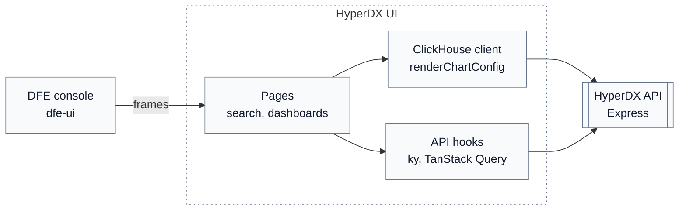

# Frontend

> **Scope.** This describes UPSTREAM HyperDX's frontend, which we do not modify,
> as the DFE console frames it. It is here so the fork's own docs are readable
> on their own. Upstream's [`agent_docs/`](../../agent_docs/) is the authority,
> and anything specific to DFE is called out as such.

## Structure

Charts build their SQL in the browser and send it through the API's ClickHouse
proxy, and everything else goes through the API's REST routes.

<!-- prettier-ignore -->
*Figure 1. L3 Components -- HyperDX UI.* Up: [L2 Services -- dfe-hyperdx](README.md#the-system).

The DFE embed turns on four features, search, saved searches, the chart explorer
and dashboards (`packages/app/src/dfe/embedFeatures.ts`). A direct visit to
`/alerts`, `/sessions`, `/service-map` or `/team` is sent back to `/search`.

Key patterns:

- URL-driven state. Search filters, time ranges and dashboard contexts are
  encoded in URL parameters (`nuqs`), so every view is deep-linkable.
- Server state. TanStack Query manages API data, with hooks in `api.ts`,
  `dashboard.ts`, `savedSearch.ts`, `source.ts` and `sessions.ts`.
- Query engine in the browser. `renderChartConfig()` from `common-utils` runs
  client-side and generates parameterised SQL, sent through
  `/api/clickhouse-proxy`.
- UI library. Mantine components throughout, with Recharts and uPlot for charts,
  CodeMirror for SQL editing, and rrweb for session replay.
