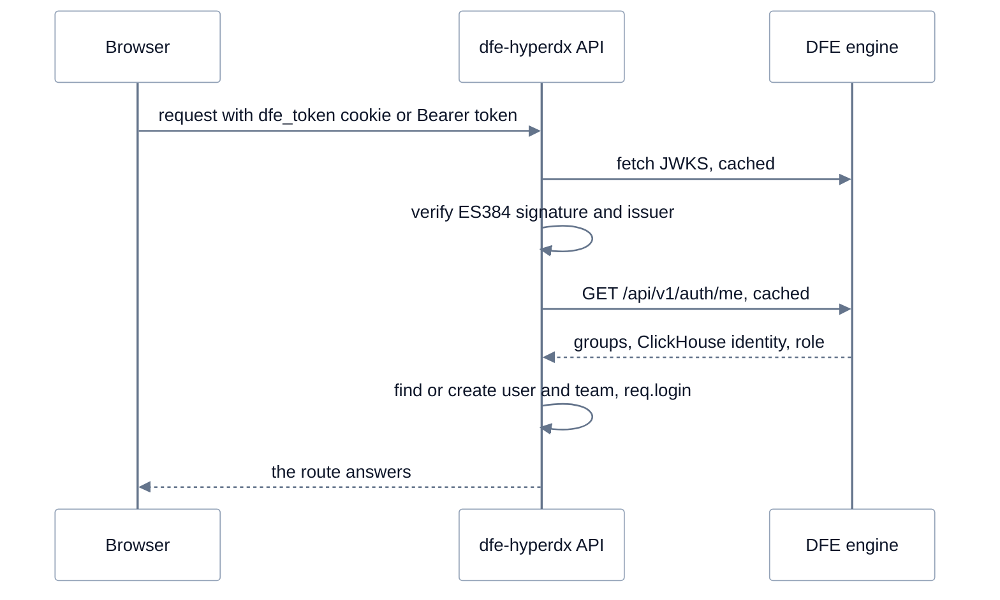
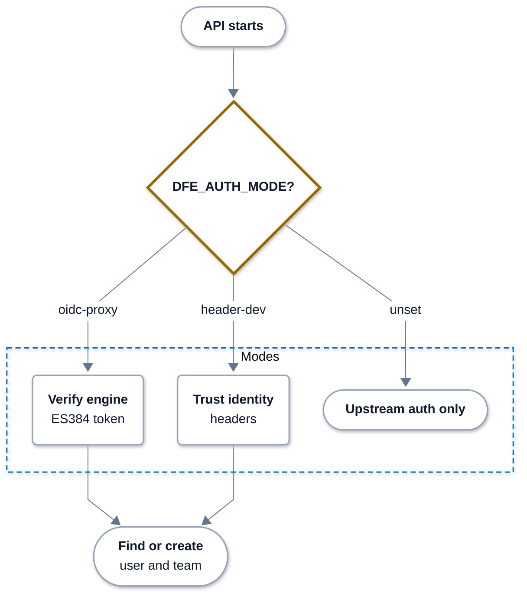

# OIDC authentication

**The DFE engine is the single JWT issuer. dfe-hyperdx verifies its token rather
than trusting a header.**

The user signs in on the DFE console, through the engine, which is the OIDC
relying party to the customer's identity provider. The console plants the
engine's ES384 token in the `dfe_token` cookie, scoped by `DFE_COOKIE_DOMAIN` to
the parent domain so the HyperDX subdomain receives it. By default the gateway
chart puts no OIDC policy on the HyperDX route, because a provider redirect
cannot complete inside the console's iframe. An operator changes that by setting
`routes.hyperdx.edgePolicy`, by adding hyperdx to `oidc.targetRoutes`, or by
enabling `jwtAuthn`, a Gateway-wide filter on `/`. Either way dfe-hyperdx
verifies the token against the engine's JWKS: it is the policy enforcement
point, and an unverified header is not an identity.

In DFE mode HyperDX's password login, registration and invite acceptance answer
404 (`dfe/middleware/legacy-auth-lockdown.ts`). None of this touches upstream's
auth code. It is one middleware, registered after Passport's session middleware
and ahead of every router, and with `DFE_AUTH_MODE` unset it is never registered
at all: the fork behaves exactly as upstream ships.

---

## The flow

The API verifies the token's signature itself, then asks the engine what the
session may do, and only an engine answer signs the user in.

_Figure 1. L4 Detail -- Engine token check. Each reply is drawn back to the
caller._ Up: [L3 Components -- HyperDX API](backend.md#structure).

Three things about the flow are worth knowing:

- `req.login(..., { session: false })` populates `req.user` exactly as Passport
  would, so every upstream route guard works unmodified. That is why the fork
  needs no changes to upstream's auth code.
- A missing or invalid token falls THROUGH, it does not 401. The route-level
  `isUserAuthenticated` guard is what rejects the request. Routes upstream
  leaves public stay public, and the guard stays the one place that rejects.
- A valid token the engine rejects is answered here. The engine's own 401 or 403
  passes straight through, a session the engine grants no group or no ClickHouse
  identity gets 403, and an engine that is unreachable, times out or answers
  with anything unreadable gets 401. None of them falls back to the token's
  claims.

---

## Where the identity comes from

`DFE_AUTH_MODE` picks the path when the API starts, and both DFE paths end in
the same user and team lookup.

_Figure 2. L4 Detail -- Identity mode._ Up:
[L3 Components -- HyperDX API](backend.md#structure).

**`header-dev` is dev-only and trusts headers without any verification.** It
exists so local development works without a running engine. Anything that can
reach the API can assert any identity under it, so it will not start with
`NODE_ENV=production`.

The token is `Authorization: Bearer <token>` if present, otherwise the
`dfe_token` cookie. The cookie header is parsed directly rather than adding
`cookie-parser`, to avoid a dependency for one lookup. In `oidc-proxy` mode a
request that does not authenticate through an engine token is anonymous, even
when it has an old dfe-hyperdx session cookie: the middleware clears the user
Passport restored before it runs.

The middleware reads these claims:

| Claim                      | Used for                                                        |
| -------------------------- | --------------------------------------------------------------- |
| `sub`                      | the user's email. Without it the request falls through          |
| `iss`                      | enforced when `DFE_ENGINE_ISSUER` is set                        |
| `exp`                      | caps how long the engine's answer for the token is kept         |
| `role`                     | the dashboard role, only when the engine's answer has none      |
| `password_change_required` | when true the request falls through and the engine is not asked |

The `groups` claim is never read. Since dfe-engine#591 a token's groups grant
nothing: the engine resolves a session's groups from the account the token
binds. So the middleware asks the engine, `GET /api/v1/auth/me` with the
caller's token.

The team is named after the ClickHouse user the engine hands the caller
(`hyperdx_identity`): one team per org, plus one platform team. An empty answer
is a refusal, never `DFE_AUTH_DEFAULT_TEAM`. A user on another team is moved
onto this one, because upstream never moves a user off the team it was created
on. The rule, the connection seeding and the startup repair are in
[team-identity.md](team-identity.md). The dashboard role is the engine's
`hyperdx_role` from the same answer, and the token's `role` claim when the
engine sends none.

The answer is cached per token for 30 seconds, never past the token's `exp`, at
most 1000 entries, and concurrent requests for one token share one lookup. That
30 seconds is how long a removed group, a changed role or a deleted account
takes to reach dfe-hyperdx. A lookup the engine could not answer is never
cached. Both the user and the team are find-or-create, so there is no
registration or invite step in DFE mode.

A token whose `sub` is `svc:dfe-engine` and whose audience includes
`dfe-hyperdx` is the engine's service identity. It signs in as an internal
principal on the default team, and reaches `/team`, `/sources`, `/connections`
and `/dfe/sources` only. Anywhere else it gets 403.

---

## Configuration and files

| Variable                 | Default              | Purpose                                                                                                   |
| ------------------------ | -------------------- | --------------------------------------------------------------------------------------------------------- |
| `DFE_AUTH_MODE`          | unset                | `oidc-proxy`, `header-dev`, or unset for stock upstream. Any other value stops the API                    |
| `DFE_ENGINE_JWKS_URL`    | -                    | engine JWKS URL, and `oidc-proxy` mode will not start without it                                          |
| `DFE_ENGINE_ISSUER`      | unset                | enforced as the `iss` claim when set                                                                      |
| `DFE_ENGINE_TIMEOUT_MS`  | `5000`               | how long a session, connection or rule request to the engine may take. The JWKS fetch uses jose's timeout |
| `DFE_AUTH_HEADER_EMAIL`  | `x-forwarded-email`  | `header-dev` only, which will not start with `NODE_ENV=production`                                        |
| `DFE_AUTH_HEADER_GROUPS` | `x-forwarded-groups` | `header-dev` only                                                                                         |
| `DFE_AUTH_DEFAULT_TEAM`  | unset                | the engine service identity's team, and the `header-dev` team when no group header is present             |

They are read in `packages/api/src/dfe/config.ts`, and `isDfeEnabled` is what
`api-app.ts` gates the middleware registration on.

| File                                   | Role                                                            |
| -------------------------------------- | --------------------------------------------------------------- |
| `dfe/middleware/jwt-verify.ts`         | entry point, mode switch, ES384 verification                    |
| `dfe/middleware/oidc-identity.ts`      | the `header-dev` path                                           |
| `dfe/controllers/engine-session.ts`    | the engine's answer for a token, cached, with team and role     |
| `dfe/controllers/user-provisioning.ts` | find-or-create the user, and move it to its team                |
| `dfe/controllers/team-provisioning.ts` | find-or-create the team                                         |
| `dfe/controllers/org-connection.ts`    | the team's one connection, as the team's ClickHouse user        |
| `dfe/tasks/team-connection-repair.ts`  | the startup delete of connections that are not their team's     |
| `dfe/config.ts`                        | the variables above                                             |
| `api-app.ts`                           | upstream's file, where a guarded block registers the middleware |

The JWKS resolver is built once and reused. `createRemoteJWKSet` does its own
fetch caching, coalescing and cooldown, so there is no key cache of ours to get
wrong.

The mistakes a change here tends to make, and what to do instead:

| Don't                                              | Do                                                        | Why                                                                            |
| -------------------------------------------------- | --------------------------------------------------------- | ------------------------------------------------------------------------------ |
| Trust `x-forwarded-email` in new code              | Read `req.user`, set by the middleware                    | The header is authoritative in `header-dev` alone, which is not production     |
| Return 401 for a missing or invalid token          | Fall through and let `isUserAuthenticated` decide         | The route guard is the one place that rejects, so public routes stay public    |
| Read the token's `groups` claim for a team         | Take `resolveEngineSession`'s team                        | The claim grants nothing. The account the token binds decides                  |
| Name a team after a group, or reuse its connection | Name it after the ClickHouse identity, and seed that user | A team's connection is what every member queries as                            |
| Fall back to a claim when the engine is down       | Refuse                                                    | A team is ClickHouse access, so an unanswered lookup must not grant one        |
| Add auth logic to upstream's `middleware/auth.ts`  | Add it under `dfe/` and register it in `api-app.ts`       | Editing upstream's auth is permanent conflict surface, and the guard blocks it |
| Widen `algorithms` beyond `['ES384']`              | Leave it pinned                                           | Algorithm confusion is the classic JWT verification bug                        |
