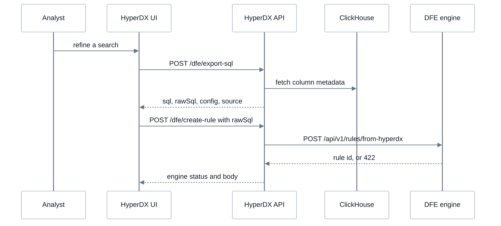

# Query-to-rule pipeline

**Turn a HyperDX search into a DFE detection rule without retyping it.** An
analyst who has found the thing in HyperDX presses a button, and the engine gets
the SQL that search runs and saves it as a rule a hunt can use.

Three routes (`POST /dfe/export-sql`, `POST /dfe/validate-rule`,
`POST /dfe/create-rule`) and one button, all under `dfe/`. Two upstream files
carry one mount each, `api-app.ts` for the routes and `DBSearchPage.tsx` for the
button, both catalogued in [what-we-changed.md](../fork/what-we-changed.md).

---

## The path

The API renders the search with the same renderer the search page uses, and the
engine decides whether the result is a rule.

_Figure 1. L4 Detail -- Search to rule. Dashed arrows are answers._ Up:
[L3 Components -- HyperDX API](backend.md#structure).

The UI then opens the created rule in the DFE console, or shows why it was
refused.

---

## The routes and the button

`packages/api/src/dfe/routers/query-export.ts`, mounted at `/dfe` behind
upstream's `isUserAuthenticated`.

**Request** - `chartConfig` (the same `SavedChartConfig` a dashboard tile uses),
plus optional `startTime` / `endTime` in milliseconds.

**Response** fields:

| Field    | What it is                                            |
| -------- | ----------------------------------------------------- |
| `sql`    | formatted, executable SQL                             |
| `rawSql` | the same query unformatted                            |
| `config` | the original chart config, for structured consumption |
| `source` | `{ name, kind, from, connection }`                    |

The query is the one the search runs. `from` is the source's table, and the
search bar, its language and every side-panel filter reach `renderChartConfig`
as the view holds them, so the renderer that runs the search writes the rule.
The engine reads the `FROM` as the table the hunt scans and the `WHERE` as the
detection logic.

The button sends no `startTime` or `endTime`, so the rule has no time bound. The
saved chart config has no `timestampValueExpression`, so the renderer emits
none, and the hunt runner supplies its window. The engine strips the
display-only rest (`LIMIT`, `SETTINGS`, time buckets).

The engine expands no placeholder. A templated table such as
`{{org_id}}.{{source_table_name}}` or a `{timestamp_condition}` does not parse,
and the engine rejects with 422, saving nothing, a rule it cannot compile or one
that matches every event.

The render is `renderChartConfig` (it needs ClickHouse column metadata, hence
the client), then `dfeParameterizedQueryToSql`, which quotes an identifier such
as `ingest-edge` where upstream inlines it bare, then `format`. A formatting
failure falls back to the raw SQL, because a valid query that reads badly beats
none.

`packages/app/src/dfe/components/CreateRuleFromSearch/` exports the search,
posts the `rawSql` to `/dfe/create-rule`, and opens the created rule at
`DFE_UI_BASE_URL/rules/<id>`. A 422 shows the engine's reason, a 403 says the
user may not create rules, and an engine that rejects the session's token (which
the route answers as 502, so the app does not redirect to a login) says the
engine did not accept the session.

Before a click, the button posts the same `rawSql` to `/dfe/validate-rule`,
which forwards it to the engine route that writes nothing,
`POST /api/v1/rules/from-hyperdx/validate`. A 422 turns the button off and says
why, and any other failure leaves it on. A 404 or 405, from an older engine,
stops the check for the session. A read-only session gets no button and no
check.

It holds plain `useState`, not react-query's `useMutation`, because upstream's
tests render `DBSearchPage` behind a PARTIAL `@tanstack/react-query` mock.

Two things moved in 2.29 and the code guards for both:

- `SavedChartConfig` became a **union**, so `chartConfig.source` is optional and
  `where` exists on the builder variant alone. Both are checked before use.
- `source.connection` is a **connection-id string**, not a populated object.

Removing either guard produces a runtime failure on some chart types.

The mistakes a change here tends to make, and what to do instead:

| Don't                                            | Do                                        | Why                                                        |
| ------------------------------------------------ | ----------------------------------------- | ---------------------------------------------------------- |
| Assume `chartConfig.where` exists                | Check `'where' in chartConfig` first      | It is a union. Raw-SQL and PromQL variants have no `where` |
| Swap the table or the time filter for a template | Render against `source.from` as it stands | The engine expands no placeholder and rejects the rule     |
| Rewrite the search into SQL by hand              | Let `renderChartConfig` render it         | The search page runs the same renderer                     |
| Add a react-query hook to this component         | Use plain state                           | Upstream's partial mock of that module breaks their tests  |
