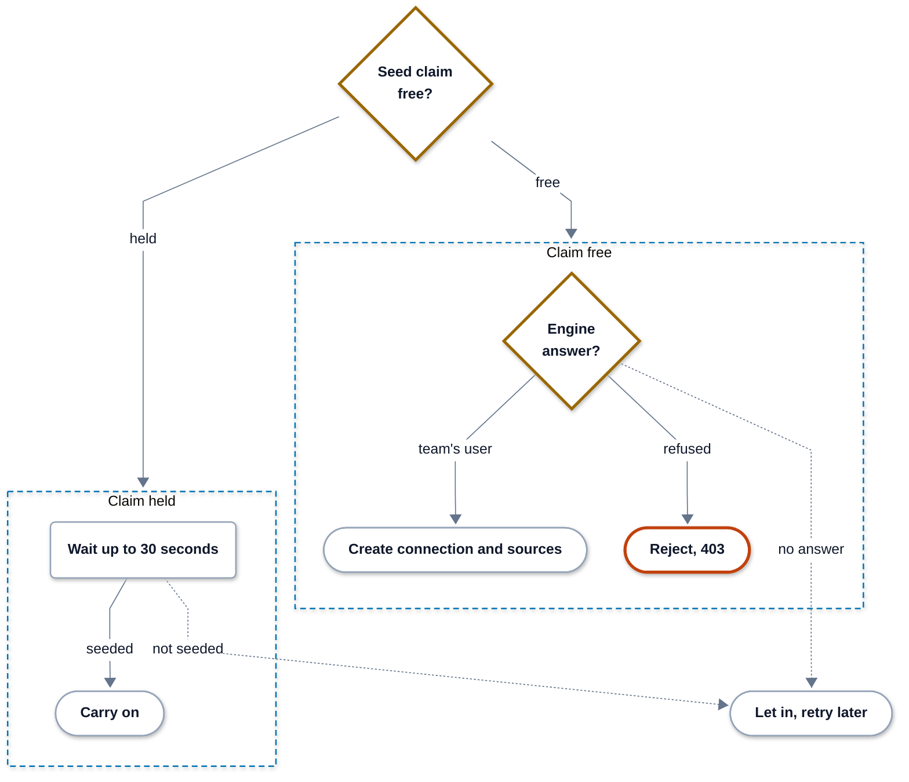

# Team identity

**A dfe-hyperdx team is the ClickHouse user its members read as.**

The engine hands every session one ClickHouse identity: `dfe_query_reader` for a
caller holding `query:execute` at system scope through a role other than
`org_viewer`, else `dfe_org_<org>` for a caller that resolves to exactly one
org. The team is named after that username, so there is one team per org plus
one platform team, and two users share a team only when the engine gives them
the same identity. How the API learns it:

- `GET /api/v1/auth/me` answers `hyperdx_identity`, the username
  `GET /api/v1/hyperdx/connection` hands the same caller, without its password.
  `dfe/controllers/engine-session.ts` names the team after it.
- An empty `hyperdx_identity` is a refusal (403). That is a caller with no
  `query:execute`, or one spanning several orgs.
- An engine that sends no `hyperdx_identity` is asked the connection read
  instead, and only its `username` is kept.
- The answer is cached per token for 30 seconds, never past the token's `exp`. A
  group change reaches dfe-hyperdx in that window.
- The dashboard role comes from the same answer: `hyperdx_role`, falling back to
  the token's `role` claim when the engine sends none. See
  [oidc-authentication.md](oidc-authentication.md).

## Seeding the connection

`dfe/controllers/org-connection.ts` runs on every request, after the user is
placed on the team. A team holding its user goes on, a team holding any other
user rejects the session, and a team holding none is seeded.

```mermaid
---
config:
  theme: base
  look: neo
  fontFamily: Inter, -apple-system, Segoe UI, Roboto, Helvetica, Arial, sans-serif
  flowchart:
    curve: linear
    nodeSpacing: 40
    rankSpacing: 64
    padding: 18
    wrappingWidth: 280
    htmlLabels: true
  elk:
    preset: modelOrder
  themeVariables:
    fontSize: 15px
    lineColor: "#64748B"
    primaryTextColor: "#0F172A"
    nodeBorder: "#334155"
    clusterBorder: "#0072B2"
    edgeLabelBackground: "#FFFFFF"
  themeCSS: >-
    p{margin:0}
    .node[data-look] rect,.node[data-look] path,.node[data-look] polygon,.node[data-look] .outer-path{filter:drop-shadow(0 1px 2px rgba(15,23,42,.10)) drop-shadow(0 6px 14px rgba(15,23,42,.10))}
    .node rect{rx:10px;ry:10px}
    .cluster rect{rx:16px;ry:16px}
    .node .label div{min-width:150px}
    .node.decision .label div{min-width:0}
    .cluster[data-look] rect{filter:none}
    .nodeLabel{line-height:1.35}
    .nodeLabel b{font-weight:600;font-size:15px;letter-spacing:-0.01em}
    .nodeLabel span{font-size:12.5px;font-weight:400;color:#334155}
    .cluster-label span.nodeLabel{display:inline-block;background:#FFFFFF;color:#0B2A3F;border:1.5px solid #0072B2;border-radius:999px;padding:2px 12px;font-size:11.5px;font-weight:700;letter-spacing:.09em;text-transform:uppercase}
    .flowchart-link{stroke-width:1.75px}
    .labelBkg{background:transparent!important}
    span.edgeLabel{display:inline-block;background:#FFFFFF!important;color:#1E293B;border:1px solid #94A3B8;border-radius:999px;padding:2px 10px;font-size:12px;font-weight:500}
    span.edgeLabel p{background:transparent!important}
    .label-icon{width:20px;height:20px;vertical-align:-4px;margin-right:6px}
    .icon-shape path[stroke-width="0"][fill="none"]{fill:#FFFFFF;stroke:#FFFFFF;stroke-width:12px;stroke-linejoin:round}
    .icon-shape p{background:transparent!important;color:#0F172A}
    .ingest .label-icon{color:#0E8A7D}
    .xform .label-icon{color:#7B4FB0}
    .load .label-icon{color:#0072B2}
    .bus .label-icon{color:#A8517F}
    .store .label-icon{color:#00785A}
    .ui .label-icon{color:#D9480F}
    .ext .label-icon{color:#64748B}
---
flowchart LR
  accTitle: L4 Detail -- Team connection check
  accDescr: On every request the API checks the team's connection. A connection as the team's own ClickHouse user lets the request carry on, one as another user is refused with 403, and no connection starts a seed.
  request(["<b>Request on a team</b>"])
  held{"<b>Team holds<br/>a connection?</b>"}
  carry(["<b>Carry on</b>"])
  refuse(["<b>Reject, 403</b>"])
  seed("<b>Seed the connection</b>")
  request --> held
  held -->|team's user| carry
  held -->|other user| refuse
  held -->|none| seed
  class request,carry,seed part
  class held decision
  class refuse error
  classDef ext fill:#F4F6F8,stroke:#94A3B8,stroke-width:1.5px,stroke-dasharray:5 4,color:#0F172A
  classDef ingest fill:#FFFFFF,stroke:#0E8A7D,stroke-width:3px,color:#0F172A
  classDef xform fill:#FFFFFF,stroke:#7B4FB0,stroke-width:3px,color:#0F172A
  classDef load fill:#FFFFFF,stroke:#0072B2,stroke-width:3px,color:#0F172A
  classDef bus fill:#FFFFFF,stroke:#A8517F,stroke-width:3px,color:#0F172A
  classDef store fill:#FFFFFF,stroke:#00785A,stroke-width:3px,color:#0F172A
  classDef ui fill:#FFFFFF,stroke:#D9480F,stroke-width:3px,color:#0F172A
  classDef decision fill:#FFFFFF,stroke:#9A6700,stroke-width:3px,color:#0F172A
  classDef error fill:#FFFFFF,stroke:#C2410C,stroke-width:3px,color:#0F172A
  classDef control fill:#FFFFFF,stroke:#334155,stroke-width:3px,color:#0F172A
  classDef part fill:#FFFFFF,stroke:#94A3B8,stroke-width:1.5px,color:#0F172A
```



_Figure 1. L4 Detail -- Team connection check._ Up:
[L3 Components -- HyperDX API](backend.md#structure).

A seed takes a claim first. One request per team holds the seed claim and asks
the engine, and the rest wait up to 30 seconds for it to settle.



_Figure 2. L4 Detail -- Seeding a team connection. The no answer and not seeded
arrows let the request in without a connection._ Up:
[L3 Components -- HyperDX API](backend.md#structure).

- A connection is created as the team's name and no other, so a platform admin
  arriving first on an org team cannot seed it with the platform reader.
- The `dfe_one_connection_per_team` unique index on `connections.team` makes a
  seed racing on another replica fail with a duplicate key, which reads as
  `present`. The dfe layer creates it in `oidc-proxy` mode alone, and a failure
  logs a warning without stopping a seed, because `header-dev` and upstream seed
  several `DEFAULT_CONNECTIONS` onto one team.
- A team holding no connection is seeded whatever happened before, so a failed
  first seed or a connection since deleted is restored.
- `dfe/models/team-seed.ts` holds one claim per team, atomic across replicas. A
  login's parallel requests make one seeding attempt, and a failed attempt is
  retried once the 30-second claim lapses. The attempt sets the claim settled
  when it ends, and every other request on the team waits for that mark, at most
  until the claim lapses, so none answers for a team holding its connection but
  not yet its sources.
- The `dfe_one_source_name_per_team` index is started once Mongo connects. On
  DocumentDB a unique index on a non-empty collection builds in the background,
  and a first seed that started the build would wait on it.
- A query ClickHouse rejects with code 516 flags the team's connection for a
  re-check. The team's next request asks the engine for its material and updates
  the stored host and password in place when they differ. A replica asks at most
  once every 30 seconds per team, and ClickHouse's error reaches the caller in
  the meantime.

## The startup repair

Before this rule a team was named after the first of its members' IdP groups and
seeded from whichever member arrived first, so a group team could hold a
ClickHouse user wider than some of its members were handed.
`dfe/tasks/team-connection-repair.ts` runs once per process when Mongo connects,
in `oidc-proxy` mode alone, and deletes every connection whose username is not
its team's name, orphans included.

- It never touches users or content. Members move onto their identity team on
  their next request (`placeUserOnTeam`).
- The old group team keeps its dashboards, saved searches, sources and alerts,
  without a connection. Its members no longer see that content once they move.
  Re-homing it is an operator decision.
- A failure is logged and not retried. Sessions stay fenced without it: each
  lands on its identity team, and one whose team holds any other ClickHouse user
  is refused.

Each deletion logs the team, the username and the member count, then each
emptied team's content:

```console
WARN  DFE: deleting a team connection that is not the team identity
      teamId: "6abb3e94a0702ad8a4b5265c"  team: "acme-team"  username: "dfe_query_reader"
      connectionId: "6abb3e94a0702ad8a4b52670"  members: 2
INFO  DFE: team left without a connection keeps its content
      teamId: "6abb3e94a0702ad8a4b5265c"  team: "acme-team"
      sources: 0  savedSearches: 0  dashboards: 1  alerts: 0
INFO  DFE: team connection repair complete
      checked: 3  deleted: 2
```

`team: null` is a connection whose team no longer exists.

## Evidence before the repair

Run these in `mongosh` against the dfe-hyperdx database before deploying the
release that has the repair, and keep the output. They are read-only, and every
projection is an inclusion list, so `password` and the team `apiKey` are never
returned.

Connections whose username is not their team's name, the set the repair deletes:

```javascript
db.connections.aggregate([
  {
    $lookup: {
      from: 'teams',
      localField: 'team',
      foreignField: '_id',
      as: 't',
    },
  },
  { $project: { team: 1, username: 1, teamName: { $first: '$t.name' } } },
  { $match: { $expr: { $ne: ['$username', '$teamName'] } } },
]);
```

Who sat on each of those teams, and so could read as that username:

```javascript
db.users.find({ team: ObjectId('<teamId>') }, { email: 1, team: 1 });
```

Member count per team, and the teams themselves:

```javascript
db.users.aggregate([{ $group: { _id: '$team', members: { $sum: 1 } } }]);
db.teams.find({}, { name: 1 });
```

The sources on each team and the connection each one reads through:

```javascript
db.sources.find({}, { team: 1, name: 1, connection: 1 });
```

Content each team holds, per collection:

```javascript
['savedsearches', 'dashboards', 'alerts'].map(c => ({
  [c]: db
    .getCollection(c)
    .aggregate([{ $group: { _id: '$team', n: { $sum: 1 } } }])
    .toArray(),
}));
```
