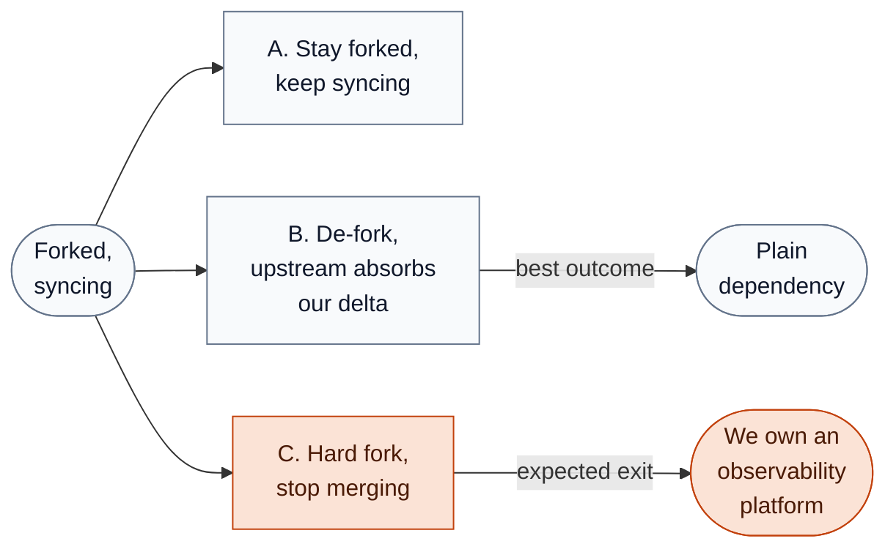

# Leaving the upstream dependency

**Forking is a position, not a destination.** The intent is to stop tracking
hyperdxio/hyperdx once HyperDX's rate of change slows and stabilises, most
likely by merging the code into DFE and keeping a copy there (C below). Until
then all our work stays in the fork. This doc exists so that decision gets made
deliberately rather than drifted into.

---

## Three ways out

From where we stand there are three ways out, and only a de-fork ends with less
to carry.

_Figure 1. L4 Detail -- Three ways out of the fork. Orange is the expensive way
out._ Up: [The fork](README.md).

**A. Stay forked (today's position).** Cheapest while upstream moves fast and
our delta is small. The cost is a recurring sync, and the whole apparatus in
[design.md](design.md) exists to keep that cost roughly flat as upstream
accelerates.

**B. Upstream absorbs our delta, and we de-fork to a plain dependency.** The
best outcome, and not hypothetical. In 2.33.0 upstream added a "kiosk mode" that
hides the nav on dashboards - our embed feature arriving under a different name.
`packages/app/src/layout.tsx` has both conditions. Every time upstream lands
something we hold, our delta shrinks and the case for B strengthens. We do not
push our delta upstream to get there, so B only happens when upstream lands what
we hold on its own.

**C. Hard fork - stop merging, copy the code into DFE.** The expected way out,
and the expensive one. Right once upstream's rate of change has slowed enough
that its releases stop being worth the merge, and we have the people to maintain
a full observability platform. Taken as a decision, never slid into by neglect.

---

## Decide on evidence, not on fatigue after a bad sync

| Signal                            | Where to get it                                                                     | Argues for                                             |
| --------------------------------- | ----------------------------------------------------------------------------------- | ------------------------------------------------------ |
| Delta size and files touched      | `.githooks/fork-surface-check.py --audit`, [what-we-changed.md](what-we-changed.md) | shrinking -> B, growing into upstream's hot files -> C |
| Sync cost over time               | the table in [sync-track-record.md](sync-track-record.md)                           | rising despite the ladder -> C                         |
| Upstream velocity                 | `--drift` and the release cadence                                                   | slowing -> C cheaper, B less urgent                    |
| What we would lose                | the package table in [../architecture/README.md](../architecture/README.md)         | more we do not maintain -> A or B                      |
| Whether the delta is ours to keep | the catalogue                                                                       | branding and config evaporate under B                  |

---

## What a hard fork would actually cost

Not a rename. It means:

- Taking ownership of the dependency tree. Upstream patches it for us, through
  the pins in its `resolutions` block that we inherit for free.
- Maintaining what we do not touch today: the OTel collector build, the MCP
  server, the CLI, the eval harness.
- Losing the delta gate's meaning. Its whole job is proving an upstream change
  did not break us. With no upstream, it is a test suite.

The security layer is the honest measure of that first cost. Every pin and patch
it holds is work upstream does that we would inherit for good. An empty
`security/overrides.yaml` is the goal state precisely because it means upstream
is still carrying that load.

> **This is a human decision, taken once, with the numbers in front of us.** It
> is not an agent's call, and not something to conclude in the middle of a sync.
