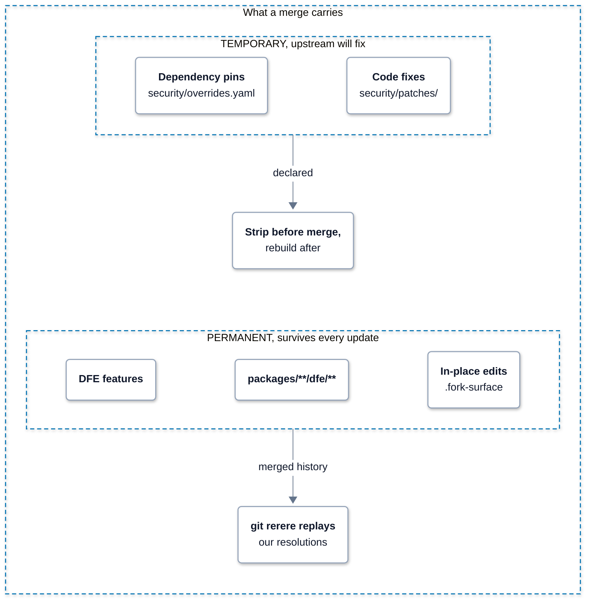
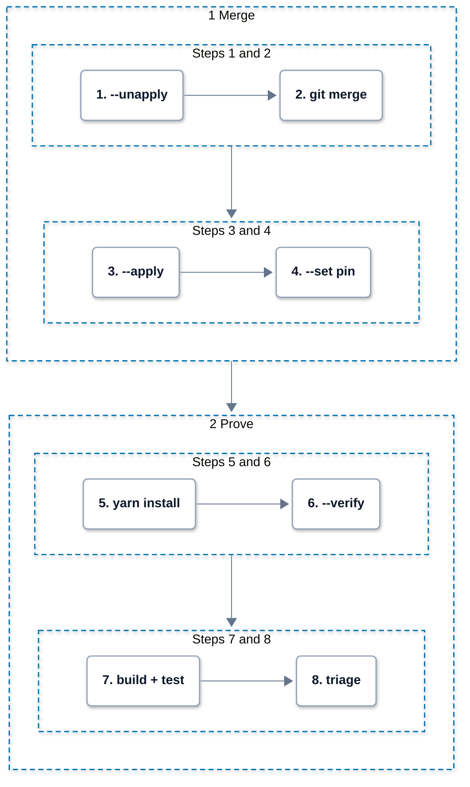

# Running an upstream sync

**The runbook.** How to move this fork onto a newer upstream HyperDX and keep
our security fixes correct while doing it.

Why the fork is built this way is [design.md](design.md). The catalogue of what
we changed is [what-we-changed.md](what-we-changed.md). This file is the
procedure.

---

## The one idea

The fork holds two kinds of content, and they need opposite treatment.

Our permanent changes ride merged history for rerere to replay, and the
temporary security layer is declared and generated, so rerere never sees it.



_Figure 1. L4 Detail -- Permanent and temporary content._ Up:
[The fork](README.md).

Our features are permanent, so they belong in merged history where rerere can
replay their conflict resolutions. Security fixes are temporary by design:
upstream ships their own within weeks. Committing one in place puts a delta we
expect to DELETE onto the permanent conflict surface, and it lands in
`package.json`'s `resolutions` block and `yarn.lock` -- the two files upstream
churns hardest.

rerere cannot help with the temporary half and must not be asked to. The
resolutions block changes contents every cycle, so a recorded conflict preimage
never matches twice. A lockfile has no meaningful "replay these hunks" answer at
all.

So the temporary layer is GENERATED. `security/overrides.yaml` and
`security/patches/` are the source, and the tree is derived from them.

---

## The cycle

`.github/workflows/upstream-sync.yml` runs this weekly and on demand, and opens
a PR. Run it by hand when you want to drive a specific upstream tag.

The cycle strips and rebuilds the security layer around the merge, then proves
the result.



_Figure 2. L4 Detail -- The sync cycle. Read each stage left to right, then
down._ Up: [The fork](README.md).

```bash
git switch -c sync/upstream-2.34.0 main
scripts/security-override.py --unapply        # 1
git merge '@hyperdx/app@2.34.0'               # 2
scripts/security-override.py --apply          # 3
scripts/upstream-pin.py --set '@hyperdx/app@2.34.0'   # 4
yarn install                                  # 5
yarn up -R $(scripts/lockfile-floor.py --names)
scripts/security-override.py --verify         # 6
scripts/lockfile-floor.py
scripts/upstream-pin.py --verify
yarn build && yarn test                       # 7
scripts/security-triage.py --audit --patches --carried   # 8
```

Step 7 is the only step that proves anything. rerere is textual: a merge can
apply cleanly and still have broken a DFE delta. The tests are what say
otherwise.

---

## What steps 1 to 3 do

### 1. Strip, so there is nothing to conflict on

`--unapply` rewrites `resolutions` back to upstream's block at our current base
and reverse-applies every patch. The tree matches upstream where the temporary
layer used to be, so git takes upstream's version of those hunks whole and the
merge never sees a delta there.

### 2. Merge

rerere replays previously-recorded resolutions for our PERMANENT deltas.
`yarn.lock` is routed to `scripts/merge-lockfile.sh`, which takes upstream's
copy outright. Anything left conflicting is a three-way conflict on a catalogued
file.

A file we deleted that upstream then edits is a modify/delete conflict, which
rerere cannot record, so `scripts/resolve-fork-deleted.py` runs straight after
the merge and `git rm`s each conflicted path listed in `.fork-deleted`. A text
conflict, or a modify/delete on an unlisted path, still stops the sync.

**A replayed resolution is not a correct one.** rerere reproduces the edit that
resolved a conflict whose preimage matched, and it has no idea whether the
result still means anything. The failure it produces is specific and worth
recognising: our side of a hunk lands over upstream's side of the surrounding
code, so the file references names nothing imports, or declares parameters
nobody passes.

2.33.0 did exactly this to `OnboardingModal.tsx` - our import block, upstream's
body, seven type errors. It survived six green workflow runs, because the gate
built common-utils and ran jest, and jest transpiles rather than typechecks. The
gate runs `yarn lint` (per package: eslint + `tsc --noEmit`) BEFORE the tests,
which is the check that was missing.

The general form is worth keeping in mind, because it bit twice in one week: a
gate that does not exercise the thing it claims to cover reports success from an
empty run. The other instance was `--unapply` against an empty register -
workflow runs, green, proving only that nothing happened.

### 3. Rebuild, and find out what upstream took off our hands

`--apply` layers the register back over the NEW upstream block, and applies each
entry ONLY where it raises the floor.

Drop that clause and a forgotten entry does harm. Upstream pins the same
packages we would. An entry left in the register after upstream passes it does
not go quietly stale: a `^2.0.2` pin against an upstream shipping 2.1.2 drags
the whole tree BACKWARDS onto the vulnerable line. Taking the higher of the two
makes a forgotten entry inert rather than harmful, and `--check` still nags
until someone deletes it.

A patch that no longer applies is REPORTED, never forced. That is the signal the
cycle exists to produce.

---

## What steps 5 and 6 do

### 5. The lockfile

The merge took upstream's lockfile whole, so our fork-only entries are missing
until `yarn install` re-derives them. Use `--mode=update-lockfile` first if you
want the resolution step on its own. Do NOT use `--immutable` here. It is the
right flag everywhere else and the wrong one at exactly this point.

`yarn install` re-derives only what our `package.json` asks for. A fix main
holds in the lockfile alone - a `yarn up -R` inside a declared range - is gone
after the merge, and nothing fails. The 2.40.0 sync lost seven PRs of them,
Next's RCE fix among them.

`scripts/lockfile-floor.py` diffs the resolved versions against the base branch
and names every package that fell.
`yarn up -R $(scripts/lockfile-floor.py --names)` puts them back inside their
declared ranges, and the sync workflow runs both. `fork-surface.yml` runs the
check on every PR and fails one that leaves a package below main's. An intended
downgrade goes in `security/lockfile-floor-allow.txt` as `<package> <reason>`.

### 6. The invariants

Checked here and again on every PR by `fork-surface.yml`:

```text
package.json resolutions == upstream's block at our base
                            + the register, applied only where it raises the floor

every security/patches/*.patch applies cleanly, in ONE direction only

.upstream-version == git merge-base HEAD upstream/main
```

Generated state drifts silently the moment somebody hand-edits the block, and a
sync is the worst possible moment to discover it.

"In one direction only" is not pedantry. `git apply` searches outward from the
hunk header, so a patch whose post-image sits elsewhere in the file -- a second
call site upstream ships safe -- reverse-applies THERE while the intended target
sits untouched. Such a patch reads as applied while the fix is absent, and
stripping it before a merge rewrites upstream's correct code into the vulnerable
code. The tools call that `ambiguous` and reject it. The fix is to re-derive the
patch against the current tree so it names one site.

The same workflow runs the tooling's own test suites before any of the above:

```bash
python3 -m unittest discover -s scripts/__tests__ -v
```

They belong in front of the invariants rather than beside them, because every
line above is a reading taken with those tools. A green check from a broken
guard proves nothing, and these particular tools decide what fails the build and
what gets stripped before a merge -- so a regression in them surfaces during a
sync rather than on the PR that caused it.

---

## Adding a security fix

Both kinds need HIGH or CRITICAL severity AND a real vector -- the vulnerable
path has to be reachable in how DFE actually runs this. "npm audit says high" is
not a vector. If you cannot write down what input reaches which call, there is
nothing to pin.

**A dependency pin.** Add an entry to `security/overrides.yaml` with every field
filled in, then `--apply && yarn install`. We fix it here and do not raise it
upstream. `upstream:` takes the upstream issue or release that tracks the fix
where one exists, else `none`. `--check` reads upstream's lockfile, so the pin
still unwinds the moment upstream catches up on its own.

**A code fix.** Fix the file in your working tree, then:

```bash
git diff -- <the file> > security/patches/0001-<slug>.patch
git checkout -- <the file>
scripts/security-override.py --apply
```

The numeric prefix is the apply order and reverses for unapply, so renumbering a
patch changes what applies first. See
[the patch series contract](../../security/patches/README.md).

---

## When a patch stops applying

That is the cycle working, not failing. Telling the two possible causes apart
needs judgement rather than a comparison, and each has its own fix.

```mermaid
---
config:
  theme: base
  look: neo
  fontFamily: Inter, -apple-system, Segoe UI, Roboto, Helvetica, Arial, sans-serif
  flowchart:
    curve: linear
    nodeSpacing: 40
    rankSpacing: 64
    padding: 18
    wrappingWidth: 280
    htmlLabels: true
  elk:
    preset: modelOrder
  themeVariables:
    fontSize: 15px
    lineColor: "#64748B"
    primaryTextColor: "#0F172A"
    nodeBorder: "#334155"
    clusterBorder: "#0072B2"
    edgeLabelBackground: "#FFFFFF"
  themeCSS: >-
    p{margin:0}
    .node[data-look] rect,.node[data-look] path,.node[data-look] polygon,.node[data-look] .outer-path{filter:drop-shadow(0 1px 2px rgba(15,23,42,.10)) drop-shadow(0 6px 14px rgba(15,23,42,.10))}
    .node rect{rx:10px;ry:10px}
    .cluster rect{rx:16px;ry:16px}
    .node .label div{min-width:150px}
    .node.decision .label div{min-width:0}
    .cluster[data-look] rect{filter:none}
    .nodeLabel{line-height:1.35}
    .nodeLabel b{font-weight:600;font-size:15px;letter-spacing:-0.01em}
    .nodeLabel span{font-size:12.5px;font-weight:400;color:#334155}
    .cluster-label span.nodeLabel{display:inline-block;background:#FFFFFF;color:#0B2A3F;border:1.5px solid #0072B2;border-radius:999px;padding:2px 12px;font-size:11.5px;font-weight:700;letter-spacing:.09em;text-transform:uppercase}
    .flowchart-link{stroke-width:1.75px}
    .labelBkg{background:transparent!important}
    span.edgeLabel{display:inline-block;background:#FFFFFF!important;color:#1E293B;border:1px solid #94A3B8;border-radius:999px;padding:2px 10px;font-size:12px;font-weight:500}
    span.edgeLabel p{background:transparent!important}
    .label-icon{width:20px;height:20px;vertical-align:-4px;margin-right:6px}
    .icon-shape path[stroke-width="0"][fill="none"]{fill:#FFFFFF;stroke:#FFFFFF;stroke-width:12px;stroke-linejoin:round}
    .icon-shape p{background:transparent!important;color:#0F172A}
    .ingest .label-icon{color:#0E8A7D}
    .xform .label-icon{color:#7B4FB0}
    .load .label-icon{color:#0072B2}
    .bus .label-icon{color:#A8517F}
    .store .label-icon{color:#00785A}
    .ui .label-icon{color:#D9480F}
    .ext .label-icon{color:#64748B}
---
flowchart LR
  accTitle: L4 Detail -- A patch that stops applying
  accDescr: A patch that no longer applies means either upstream fixed it, so the patch and its register entry are deleted, or the code moved, so the hunk is re-derived against the new file.
  stale(["<b>Patch no longer applies</b>"])
  q{"<b>Fixed upstream,<br/>or code moved?</b>"}
  drop(["<b>Delete the patch</b><br/><span>and its entry</span>"])
  rederive(["<b>Re-derive</b><br/><span>the hunk</span>"])
  stale --> q
  q -->|fixed| drop
  q -->|moved| rederive
  class stale,drop,rederive part
  class q decision
  classDef ext fill:#F4F6F8,stroke:#94A3B8,stroke-width:1.5px,stroke-dasharray:5 4,color:#0F172A
  classDef ingest fill:#FFFFFF,stroke:#0E8A7D,stroke-width:3px,color:#0F172A
  classDef xform fill:#FFFFFF,stroke:#7B4FB0,stroke-width:3px,color:#0F172A
  classDef load fill:#FFFFFF,stroke:#0072B2,stroke-width:3px,color:#0F172A
  classDef bus fill:#FFFFFF,stroke:#A8517F,stroke-width:3px,color:#0F172A
  classDef store fill:#FFFFFF,stroke:#00785A,stroke-width:3px,color:#0F172A
  classDef ui fill:#FFFFFF,stroke:#D9480F,stroke-width:3px,color:#0F172A
  classDef decision fill:#FFFFFF,stroke:#9A6700,stroke-width:3px,color:#0F172A
  classDef error fill:#FFFFFF,stroke:#C2410C,stroke-width:3px,color:#0F172A
  classDef control fill:#FFFFFF,stroke:#334155,stroke-width:3px,color:#0F172A
  classDef part fill:#FFFFFF,stroke:#94A3B8,stroke-width:1.5px,color:#0F172A
```



_Figure 3. L4 Detail -- A patch that stops applying._ Up: [The fork](README.md).

`scripts/security-triage.py --patches` drafts which, with evidence. It PROPOSES
only -- see below.

---

## The triage step, and its limits

`scripts/security-triage.py` answers the questions the mechanical tooling
cannot. It reads the signals this repo produces rather than rescanning:

| Flag        | Question                                            | Source it reads                      |
| ----------- | --------------------------------------------------- | ------------------------------------ |
| `--audit`   | This advisory is HIGH. Is it reachable HERE?        | Dependabot alerts via `gh`           |
| `--code`    | Is this scanner finding on OUR line real?           | `attribute-findings.py --json`       |
| `--patches` | Did upstream fix this, or did the code just move?   | `security/patches/` against the tree |
| `--carried` | Has upstream landed an equivalent for what we hold? | the register against upstream's log  |

**Mechanical first.** Every finding answered deterministically is one that needs
no key, no network and no human, so the existing signals do as much as they can
before anything reaches the model:

- Dependabot has `dependency.scope`. A development-scoped advisory is build
  tooling that never reaches the shipped image, so it is answered outright. On
  this repo: 13 of 72 settled for free.
- `attribute-findings.py` has sorted scanner findings into OURS / ACCEPTED /
  INHERITED, so only OURS is drafted. That bucket is usually empty.

The model is asked the residue, not the pile.

It writes a markdown report and nothing else. It does not edit the register,
apply a patch, or clear a finding. Reachability is a human verdict: a model that
could clear its own findings would rebuild the alert queue the fork's inverted
scanner settings exist to avoid.

With no `ANTHROPIC_API_KEY` or no `anthropic` SDK it prints the mechanical facts
and marks each unjudged section `NOT JUDGED`. A sync is never blocked by an
expired secret.

---

## Where the triage reads its signals

**CI reads Dependabot through a GitHub App, not a PAT.** The workflow
`GITHUB_TOKEN` cannot reach the alerts endpoint whatever `permissions:` says -
it wants the app-level Dependabot-alerts permission, and the 403 reads exactly
like a missing scope on your own account.

The sync workflow mints a token from `hyperi-container-mgt`, whose client id
(`vars.CONTAINER_MGT_CLIENT_ID`) and private key
(`secrets.CONTAINER_MGT_APP_PRIVATE_KEY`) are org-wide, so no new secret is
needed here. What IS needed, once, from an org owner: add **Dependabot alerts:
Read** to that app's permissions and accept it on the installation.

Until then the triage falls back to `yarn npm audit`, loses the `scope` field,
and says so in the report rather than looking like a repo with 18 advisories
instead of 72. A `DEPENDABOT_TOKEN` secret is still honoured as a fallback if
someone would rather use a PAT, but the App is the house standard.

**CodeQL default setup is on**, but the triage reads code findings as SARIF
through `attribute-findings.py`, and `fork-security.yml` feeds it semgrep's.
`attribute-findings.py` serves CodeQL's SARIF as readily, so adding it needs no
change to the triage. **Renovate** is scoped to the files its `includePaths`
names ([design.md](design.md#security-scanning-is-inverted-here)) and produces
no signal on upstream's dependency tree by design.

**Never use `gh api repos/{owner}/{repo}/...` in this repo.** A fork has two
remotes, and with no default set gh resolves the placeholders to UPSTREAM: the
query asks hyperdxio/hyperdx for its Dependabot data and returns a 403 that
reads like a missing token scope. Resolve the slug from `origin` instead.

---

## Per-clone setup is not inherited

`rerere.enabled`, `core.hooksPath` and the `yarn.lock` merge driver are all
local git config. A fresh clone, a container and an agent sandbox start without
them, and an unconfigured merge driver fails OPEN -- git falls back to a text
merge and hands you a megabyte of conflict markers.

```bash
./scripts/fork-setup.sh   # once per clone
```

The CI workflows configure the same things themselves, because a runner checkout
has none of it either.

---

## Before you start

```bash
git fetch upstream
.githooks/fork-surface-check.py --drift
```

`--drift` answers "has upstream touched anything we hold a delta in?" That is
the cheap moment to shrink a delta down the
[cheapest-edit ladder](design.md#the-cheapest-edit-ladder), long before a merge
turns it into a conflict. `upstream-drift.yml` runs it daily.

**A stale `upstream/main` lies quietly.** One measurement taken against a ref
that had not been fetched in weeks reported 34 commits of drift and 2 conflicts,
and a fresh fetch showed 122 commits and 11 conflicts. Nothing announces the
staleness - it just tells you the sync is smaller than it is. The daily CI
number fetches every run, so trust it over whatever your laptop says.

---

## Priming rerere

rerere has nothing to replay until a resolution is recorded, and **`rr-cache` is
PER-CLONE**. Resolving a conflict on your laptop does not prime CI, and CI's
cache does not prime you. Each has to see the conflict once.

Prime a clone by doing an upstream merge by hand on a `sync/<tag>` branch,
resolving each conflict, and running `git rerere` (or committing, which records
the same thing). CI persists its own cache via actions/cache, so the first
scheduled run after a new conflict files a drift issue and the run after that
replays.

Use MERGE, not rebase-onto-upstream. This is a shared repo, and rerere replays
either way.

---

## When the merge gets too ugly

The cycle above assumes merge debt stays low. When it does not, the fallback is
to re-fork and replay: take the target upstream tag fresh, re-apply each
catalogued in-place edit from `.fork-surface` against the NEW original (smallest
edit first, per the ladder), regenerate the security layer with `--apply` rather
than carrying the old block across, and move the pin.

[what-we-changed.md](what-we-changed.md) is what makes that tractable, which is
why it has to stay accurate.

---

## Expect `Build All-in-One Image` to fail on a sync PR

It is upstream's workflow, and it dies with `no space left on device` partway
through the collector's Go build. Not a regression, and not something to fix by
editing upstream's workflow.

The job builds the whole Node app AND the Go collector into one image on a
hosted runner, with no disk-reclaim step. The collector alone pulls the full
prometheus and cloud-SDK dependency set. On an ordinary upstream PR the path
filters keep it dormant. A sync touches those paths, so it runs, and it does not
fit.

It is worth knowing this is capacity and nothing else, because the error looks
alarming. Our only deltas anywhere near it are config and entry-script -
`docker/otel-collector/*.yaml`, `docker/hyperdx/entry.prod.sh` - so the Go
compile that runs out of room is byte-identical to upstream's. Built on adequate
hardware (12 cores, 540G free), the same commit produces a 2.62GB
`all-in-one-auth` image with zero disk errors. Verified for 2.33.0. Do that
again rather than trusting this paragraph if the failure ever looks different.

The standing options are a self-hosted runner, a disk-reclaim step (upstream
surface, so no), or accepting the red check on sync PRs. We take the last.

---

## Related

- [design.md](design.md) - why the fork is built this way
- [what-we-changed.md](what-we-changed.md) - the change catalogue
- [sync-track-record.md](sync-track-record.md) - what each sync cost
- [leaving-upstream.md](leaving-upstream.md) - how this ends
- [../../security/patches/README.md](../../security/patches/README.md) - the
  patch series contract
