# What we changed

The catalogue of our divergence from upstream HyperDX. Keep it accurate: when
you add, remove or move a fork change, update this file in the same commit.

Two machine-readable companions carry the parts a script can check, and they are
the source of truth where this prose disagrees:

- `.fork-surface` - every sanctioned in-place edit to an upstream file
- `.upstream-version` - which upstream release we are built on

Why the fork is built this way is [design.md](design.md). How to move it to a
newer upstream is [sync-cycle.md](sync-cycle.md).

---

## Upstream base

- Upstream: <https://github.com/hyperdxio/hyperdx> (HyperDX v2)
- Synced to whatever `.upstream-version` records. It is verified against
  `git merge-base` on every PR, so it cannot quietly drift from the tree.
- Imported at commit `e58f01d` "Initial HyperDX commit", a FLATTENED copy of
  upstream rather than a continuation of their history. `scripts/fork-setup.sh`
  grafts it back on so blame and ancestry work - see
  [design.md](design.md#the-squashed-import-and-the-graft-that-repairs-it).
- The `upstream` remote is required. Without it the conflict-surface guard
  cannot tell our files from upstream's, and the verify checks decline to run
  rather than pass on nothing.
- Our changes live on `main`, merged in as feature PRs, not as a curated patch
  series rebased on a tracked upstream. That is why an upstream bump is a merge
  with real conflict surface rather than a clean rebase.

**RETIRED - the `.dfe[CHG]` shadow-copy convention.** Modified copies of
upstream files were once kept beside the originals with a `.dfe[CHG]` suffix. It
was never wired up (nothing imported the copies, the docker build ignored them),
it had drifted badly, and it blocked the build. All 32 shadow files were
removed. We modify upstream files IN PLACE now, which is why every such edit
must be catalogued in `.fork-surface`.

---

## Where our code lives

Additive paths cannot conflict, and every in-place edit is listed in
`.fork-surface`.

```mermaid
---
config:
  theme: base
  look: neo
  fontFamily: Inter, -apple-system, Segoe UI, Roboto, Helvetica, Arial, sans-serif
  flowchart:
    curve: linear
    nodeSpacing: 40
    rankSpacing: 64
    padding: 18
    wrappingWidth: 280
    htmlLabels: true
  elk:
    preset: modelOrder
  themeVariables:
    fontSize: 15px
    lineColor: "#64748B"
    primaryTextColor: "#0F172A"
    clusterBorder: "#0072B2"
    edgeLabelBackground: "#FFFFFF"
  themeCSS: >-
    p{margin:0}
    .node[data-look] rect,.node[data-look] path,.node[data-look] polygon,.node[data-look] .outer-path{filter:drop-shadow(0 1px 2px rgba(15,23,42,.10)) drop-shadow(0 6px 14px rgba(15,23,42,.10))}
    .node rect{rx:10px;ry:10px}
    .cluster rect{rx:16px;ry:16px}
    .node .label div{min-width:150px}
    .node.decision .label div{min-width:0}
    .cluster[data-look] rect{filter:none}
    .nodeLabel{line-height:1.35}
    .nodeLabel b{font-weight:600;font-size:15px;letter-spacing:-0.01em}
    .nodeLabel span{font-size:12.5px;font-weight:400;color:#334155}
    .cluster-label span.nodeLabel{display:inline-block;background:#FFFFFF;color:#0B2A3F;border:1.5px solid #0072B2;border-radius:999px;padding:2px 12px;font-size:11.5px;font-weight:700;letter-spacing:.09em;text-transform:uppercase}
    .flowchart-link{stroke-width:1.75px}
    .labelBkg{background:transparent!important}
    span.edgeLabel{display:inline-block;background:#FFFFFF!important;color:#1E293B;border:1px solid #94A3B8;border-radius:999px;padding:2px 10px;font-size:12px;font-weight:500}
    span.edgeLabel p{background:transparent!important}
    .label-icon{width:20px;height:20px;vertical-align:-4px;margin-right:6px}
    .ingest .label-icon{color:#0E8A7D}
    .xform .label-icon{color:#7B4FB0}
    .load .label-icon{color:#0072B2}
    .bus .label-icon{color:#A8517F}
    .store .label-icon{color:#00785A}
    .ui .label-icon{color:#D9480F}
    .ext .label-icon{color:#64748B}
---
flowchart LR
  accTitle: L4 Detail -- Where our code lives
  accDescr: Additive paths, the api, app and common-utils dfe directories, the dfe theme, the security and githooks directories, and our docs and scripts, cannot conflict. In-place edits to upstream files conflict on a sync, and .fork-surface lists every one.
  subgraph additive["Additive, cannot conflict"]
    direction TB
    dfedirs("<b>packages/*/src/dfe/**</b>")
    theme("<b>packages/app/src/theme/themes/dfe/**</b>")
    tools("<b>security/, .githooks/,</b><br/><span>our docs and scripts</span>")
  end
  subgraph inplace["In place, conflicts on sync"]
    direction TB
    surface("<b>.fork-surface</b><br/><span>lists every one</span>")
  end
  additive ~~~ inplace
  classDef ext fill:#F4F6F8,stroke:#94A3B8,stroke-width:1.5px,stroke-dasharray:5 4,color:#0F172A
  classDef ingest fill:#FFFFFF,stroke:#0E8A7D,stroke-width:3px,color:#0F172A
  classDef xform fill:#FFFFFF,stroke:#7B4FB0,stroke-width:3px,color:#0F172A
  classDef load fill:#FFFFFF,stroke:#0072B2,stroke-width:3px,color:#0F172A
  classDef bus fill:#FFFFFF,stroke:#A8517F,stroke-width:3px,color:#0F172A
  classDef store fill:#FFFFFF,stroke:#00785A,stroke-width:3px,color:#0F172A
  classDef ui fill:#FFFFFF,stroke:#D9480F,stroke-width:3px,color:#0F172A
  classDef decision fill:#FFFFFF,stroke:#9A6700,stroke-width:3px,color:#0F172A
  classDef error fill:#FFFFFF,stroke:#C2410C,stroke-width:3px,color:#0F172A
  classDef control fill:#FFFFFF,stroke:#334155,stroke-width:3px,color:#0F172A
  classDef part fill:#FFFFFF,stroke:#94A3B8,stroke-width:1.5px,color:#0F172A
  class dfedirs,theme,tools part
  class surface error
  style additive fill:none,stroke:#0072B2,stroke-width:1.5px,stroke-dasharray:6 4
  style inplace fill:none,stroke:#0072B2,stroke-width:1.5px,stroke-dasharray:6 4
```

_Figure 1. L4 Detail -- Where our code lives. Orange is the conflict surface._
Up: [The fork](README.md).

---

## Data layer: DocumentDB

DocumentDB is PostgreSQL with the DocumentDB extensions and a Mongo
wire-protocol gateway in one container. **HyperDX application code is
unchanged** - Mongoose, `connect-mongo` and `passport-local-mongoose` all talk
to the gateway unmodified.

- `docker-compose.dfe.yml` - production override, replaces `db` with
  `documentdb` and repoints `MONGO_URI`
- `docker-compose.dfe.dev.yml` - dev override

Rationale:
[../decisions/0006-documentdb-document-store.md](../decisions/0006-documentdb-document-store.md).

## Engine token authentication

The engine signs users in, and the API verifies the engine's ES384 token from
the `dfe_token` cookie or a Bearer header against the engine's JWKS. It
find-or-creates the user, and names its team after the ClickHouse identity the
engine hands it. A request with no valid token falls through to upstream's
session auth, which the route guards then refuse.

- `packages/api/src/dfe/middleware/jwt-verify.ts` - ES384 verification against
  the engine's JWKS, and the mode switch
- `packages/api/src/dfe/middleware/oidc-identity.ts` - the dev-only `header-dev`
  path, which trusts identity headers unverified
- `packages/api/src/dfe/controllers/user-provisioning.ts` - JIT user creation
- `packages/api/src/dfe/controllers/team-provisioning.ts` - find-or-create the
  team by name
- `packages/api/src/dfe/controllers/engine-session.ts` - the engine's answer for
  a session: the team (its ClickHouse identity) and the dashboard role
- `packages/api/src/dfe/middleware/legacy-auth-lockdown.ts` - 404s HyperDX's own
  password login, registration and invite-acceptance routes in OIDC mode
- `packages/api/src/api-app.ts` - registers the identity middleware and the
  legacy-auth lockdown in one block guarded by `isDfeEnabled` (`DFE_AUTH_MODE`)

Detail:
[../architecture/oidc-authentication.md](../architecture/oidc-authentication.md).

## Authorization

**Casbin RBAC was REMOVED.** It was redundant: every HyperDX route handler
already self-scopes its queries by `team`, so tenant isolation holds without it.

**`getTeam` reads the team it is asked for (`controllers/team.ts`).** Upstream
assumes one team per deployment, so `getTeam(id)` ignored `id` and returned the
first team in the store. DFE runs one team per org plus the platform team, so
`GET /me` and `GET /team` handed every member the first team's record: its name,
its API key, and the query limits the console applies. The delta is one
expression, `findOne({})` to `findOne({ _id: id })`.
`dfe/__tests__/team-scope.int.test.ts` seeds two teams and fails without it.

Authorization is owned by the DFE engine as the policy decision point, and
enforced at the data layer by ClickHouse GRANTs. HyperDX verifies the engine's
token itself rather than trusting a header.

Rationale:
[../decisions/0004-casbin-removed.md](../decisions/0004-casbin-removed.md).

**Admin surfaces are engine-only (`dfe/middleware/admin-lockdown.ts`).** HyperDX
is embedded-only, so a human uses it for search, saved searches, dashboards and
charts - nothing else. `requireServicePrincipal` 403s any non-service principal
on the admin surfaces wired in `api-app.ts` (`/connections`, `/sources`,
`/webhooks`, `/alerts`, the external `/api/v2`, and `/mcp`), and
`blockClickhouseProxyTest` closes the connection-tester sub-route while leaving
the query proxy open. Both are a no-op when `DFE_AUTH_MODE` is unset, so
upstream behaviour and tests are unchanged. The service flag is set by
`jwt-verify.ts` for the `svc:dfe-engine` identity.

**The query proxy drops the caller's credentials
(`dfe/middleware/clickhouse-proxy-credentials.ts`).** Upstream's
`/clickhouse-proxy` forwards every incoming header and query param and sets the
connection's `X-ClickHouse-User` and `X-ClickHouse-Key` itself. A caller on
`Authorization: Bearer`, the token source `jwt-verify.ts` reads first, reached
ClickHouse with both schemes and was refused with code 516, and the `dfe_token`
cookie carried the engine token to the datastore. In DFE mode
`dropClientCredentials` removes `Authorization`, `Proxy-Authorization`,
`Cookie`, the caller's own `X-ClickHouse-User`, `-Key`, `-Quota` and
`-SSL-Certificate-Auth`, and the `user`, `password` and `quota_key` query params
ClickHouse authenticates with, before the proxy runs.
`dfe/__tests__/clickhouse-proxy-credentials.int.test.ts` proves it through the
real proxy. The delta in **`api-app.ts`** is one import and one identifier on
the `/clickhouse-proxy` mount.

**`/team` opens one read to a member (`allowTeamReadElseServicePrincipal`).**
The console calls `GET /api/team` on every page load for one flag, so a blanket
403 there logged an `HTTPError 403` on every Observe load - on a read the
lockdown exists to protect WRITES on. A signed-in member now gets the team
record with `apiKey` (a credential) and `allowedAuthMethods` (the engine's
policy to set) stripped. Every mutation keeps its 403, as does every sub-path:
`/members`, `/invitations`, `/apiKey`, `/tags`. The delta in **`api-app.ts`** is
one identifier on the `/team` mount.

**`/me` strips the same two fields (`stripMeTeamAdminFields`).** `GET /me`
embeds the caller's team record, so a member got the API key there as well. The
strip runs on the record that serialises, because the routers send a mongoose
document whose fields are getters, not own properties. The delta in
**`api-app.ts`** is one added mount ahead of upstream's `/me` line, which stays
untouched.

**A member cannot mint a personal access key or read the IaC manifest.**
`PATCH /me/accessKey` rotates a key that only opens `/api/v2` and `/mcp`, both
engine-only, and `GET /iac/import-manifest` lists the team's connection, webhook
and alert names for the team-settings export. Both now take
`requireServicePrincipal`. The delta in **`api-app.ts`** is one added mount
ahead of upstream's `/me` line and one identifier on the `/iac` mount.
`dfe/__tests__/admin-surface.int.test.ts` drives the whole admin surface as a
member and as the engine service identity through the real app, and shows a
session the engine gives no group or no ClickHouse identity provisions no user
or team.

**`requireDfeMode`** takes a DFE-only router out of the app when `DFE_AUTH_MODE`
is unset - `next('router')`, so the request 404s as it would upstream.
`dfe/routers/shipped-dashboards.ts` mounts it, inside our router rather than at
the `api-app.ts` mount, which keeps the gate off the upstream file.

**Only `admin` and `owner` change what the whole team sees
(`dfe/middleware/role-claim.ts`).** Deleting or restoring a shipped dashboard
changes it for every member. `jwt-verify.ts` takes the role from the engine's
`hyperdx_role` on `GET /api/v1/auth/me`, cached for 30 seconds, and falls back
to the token's `role` claim for an engine that sends none. The check is gated on
the role's PRESENCE, so a session with none keeps team membership as the whole
authorisation. header-dev mode sets none, so local dev is unchanged.

**The engine's `viewer` role is read-only (`refuseReadOnlyWrites`).** A team is
one ClickHouse identity, so a viewer shares its team with accounts that write,
and HyperDX routes check team membership alone. `dfeIdentityMiddleware` runs the
gate once the identity is known, so it covers every route, ones upstream adds
included. A `viewer` gets 403 on any non-read request outside the query proxy,
PromQL, the chart assistant, its favourites and profile, and the
engine-authorised SQL export and rule creation.

**A read-only session is not offered Save, Update or Create Rule
(`dfe/routers/session-role.ts`, `dfe/readOnlySession.ts`).** `GET /dfe/session`
answers `{ role, readOnly }` from the same `req.dfeRole` the gate above reads,
and `useDfeWriteActionProps` hides the three buttons with `display: none` when
`readOnly` is true. A deployment outside DFE mode has no route, and an answer
the page cannot get reads as "not read-only", so upstream's page is unchanged
there. The hook uses plain state, not react-query, because upstream's tests
render the search page behind a partial react-query mock. The server still
refuses the writes: this only stops the page offering a button that answers 403.
The only upstream delta is **`DBSearchPage.tsx`** (one import, one hook call,
and one spread on each of the Save and Update buttons). The route is mounted by
`shipped-dashboards.ts`, so `api-app.ts` is untouched. `CreateRuleFromSearch` is
ours and takes the same hook. `dfe/__tests__/readOnlySession.test.tsx` pins the
wiring.

**Restore refuses a simple request (`dfe/middleware/cross-site.ts`).** A form
post needs no CORS preflight and carries no header the posting page had to be
allowed to set, so a hostile page could aim one at
`POST /dfe/dashboards/restore-shipped` and reprovision a team's dashboards.
`requireNonSimpleRequest` 403s a state-changing request carrying neither an
`Origin` matching the host it was addressed to nor an `X-Requested-With` header.
The console's button sends the header.

It is the second layer, not the only one. dfe-ui plants the engine token in the
`dfe_token` cookie from its proxy (`apps/dfe-core-ui/src/proxy.ts`): `HttpOnly`,
`Path=/`, `SameSite=Lax`, `Secure` whenever the UI is served over https,
`Domain` set to `DFE_COOKIE_DOMAIN` so the cookie reaches the embedded HyperDX
subdomain, and `Max-Age` from the token's expiry. `SameSite=Lax` already keeps
that cookie off a cross-site POST, so the exposure was thin. The header check is
what holds when a deployment authenticates some other way.

## Request validation

**A handler gets the parsed request, not the raw one
(`dfe/validated-request.ts`).** zod-express-middleware's `validateRequest` hands
on the original request, so an undeclared key reached the mongoose write:
`PATCH /dashboards/:id` with a `team` moved the dashboard to another team. The
module swaps the library's `validateRequest` and `processRequest` exports for
one that writes the parsed params, query and body back and deletes every
`__proto__`, `constructor` and `prototype` key at any depth. Every router that
imports the library is covered, ones upstream adds included. The delta in
**`api-app.ts`** is one side-effect import above all the others, because the
swap must land before a router calls `validateRequest` at load.
`dfe/__tests__/validated-request.test.ts` pins it. Upstream's int test that
expects undeclared static-filter keys to persist is skipped by name in
`dfe-documentdb.yml`.

## DFE integration features

- `packages/api/src/dfe/controllers/org-connection.ts` - a team holds ONLY one
  connection, as the ClickHouse user it is named after, fetched from the engine
  and seeded on any request that finds none, plus its seed sources. `main` and
  `hunts` for every team (org-fenced by their row policies), and `otel_logs`,
  `otel_traces`, `otel_metrics` and `clickhouse_system` for the platform team
  alone, since operator telemetry and ClickHouse's `system` database must never
  reach an org_viewer. That source set is also the RBAC fence for the pre-canned
  dashboards - see the provisioner note below. Seeding a NEW team also runs
  `syncDashboards` for it when `DASHBOARD_PROVISIONER_DIR` is set: the
  provisioner cron fires once a minute with no run at start, so the page's first
  `GET /dashboards`, a second after the team is created, saw `[]` and the SPA
  cached it until a reload. Every request reads the team's connections, so a
  team holding another ClickHouse user refuses the session, and a team holding
  none is seeded whether its first attempt failed (the engine unreachable, or
  the reader not yet minted) or its connection was since deleted.
  `dfe/models/team-seed.ts` holds one claim per team, atomic across replicas, so
  a login's parallel requests make one seeding attempt, the rest wait for it to
  settle, and a failed attempt is retried once the 30-second claim lapses. A
  dfe-layer unique index on `connections.team` stops two replicas seeding one
  team twice, and `dfe/tasks/team-connection-repair.ts` deletes, once at
  startup, every connection that is not its team's own - see
  [../architecture/team-identity.md](../architecture/team-identity.md).
- `packages/api/src/dfe/routers/dfe-sources.ts` +
  `packages/api/src/dfe/controllers/dfe-sources.ts` -
  `PUT`/`DELETE`/`GET /dfe/sources`, engine-only. The team-scoped `/sources`
  surface writes to the CALLER's team, and the engine's service principal
  resolves to a team no human is in, so a source it deployed was invisible to
  everyone. These routes write the source to every team instead, each over that
  team's own connection, and record it in the `DfeSource` manifest so a team
  created later is seeded with it too. The fork writes only names the manifest
  claims, so the seeded set above is never replaced or deleted by a deploy.
- `packages/api/src/dfe/routers/query-export.ts` - export a saved search or SQL
  to a DFE rule
- `packages/app/src/dfe/components/CreateRuleFromSearch/` - the button that
  posts to it. Deliberately uses plain `useState`, NOT react-query's
  `useMutation`: this component is injected into upstream's `DBSearchPage`,
  whose pristine tests render that page behind a PARTIAL `@tanstack/react-query`
  mock. Pulling a second hook out of that module makes upstream's tests explode.
  Keep our delta invisible to them. **`DBSearchPage.tsx`** passes it the source
  picker's value as `sourceId`, one added line, because `chartConfig` follows
  the picker behind a 1 s debounce. The button stays disabled until the two
  match, so Create Rule exports the source on screen. The component also asks
  the engine whether the search would make a valid rule before Create can be
  pressed (`dfe/useRuleCheck.ts`, a dry run of `create-rule`). A refusal shows
  beside the button in plain words and keeps Create off. For the engine's
  `rule_empty_filter` the words are fixed and list the time bounds it dropped,
  and any other code shows the engine's `detail`. The fork decides nothing about
  what a valid rule is, and the engine stays the one judge. No upstream file
  changes, so `.fork-surface` is untouched.
- `packages/app/src/dfe/clickhouseJsonPath.ts` - native ClickHouse JSON columns.
  `col['k']` on a JSON column is `arrayElement`, which ClickHouse rejects, so we
  emit `JSONExtractString`. A JSON sub-path yields `Dynamic`, which
  `JSONExtract*` also rejects, so that ONE case is wrapped in `toString()`.
  Narrow by design - wrapping unconditionally changed the SQL for String and Map
  columns too.
- **`DBRowJsonViewer.tsx` (catalogued)** defaults `filterBlanks` to `true` in
  `DEFAULT_VIEWER_OPTIONS`, one value. A row carries every typed column of its
  source table, such as the Cisco ASA columns, and most are null on any one
  message, so they buried the fields holding data. Upstream's "Hide blank
  values" menu item turns it off, and a browser that already stored the option
  keeps its choice. `dfe/__tests__/DBRowJsonViewer.hideBlanks.test.tsx` pins it.
- `packages/app/src/dfe/patternBody.ts` - the text Event Patterns mines from a
  row. A source whose body column is a native ClickHouse `JSON` (every DFE
  source's `_json`) returns an object per row, and drain3 failed on it with
  `AttributeError: strip`. **`hooks/usePatterns.tsx` (catalogued)** passes the
  body through `dfePatternBody` at its two `stripAnsi` calls and adds one
  import: a string stays as it is, null becomes `''`, anything else is
  `JSON.stringify`. `dfe/__tests__/patternBody.test.ts` pins it.
- `packages/common-utils/src/dfe/jsonPath.ts` - native ClickHouse JSON for
  charts and filters. A JSON sub-path is `Dynamic`, which ClickHouse refuses in
  `IN`, aggregates, `GROUP BY` and `ORDER BY`, so it needs an explicit coercion.
  All the logic is here. **`core/renderChartConfig.ts` (catalogued)** has five
  added calls and nothing else - one in `renderWhereExpressionStr`, the function
  every SQL filter passes through, one in `renderSelectList`'s raw-string early
  return, which `renderSelect` and `renderGroupBy` BOTH feed, so the SELECT list
  and the GROUP BY key cannot disagree, one on the group-by columns in
  `renderSeriesLimitCte`, so its tuple matches that GROUP BY, one wrapping the
  `renderOrderBy` argument, and `dfeJsonAggregates` after `renderSelectList`
  builds each aggregate. Coercion is `toString()`, NOT the `.:String` sub-column
  upstream #2549 proposes - see the module header for the measurement that rules
  it out. A path compared with a number literal gets
  `toFloat64OrNull(toString(...))` instead, since `String = 200` is
  NO_COMMON_TYPE.

  Aggregate arguments: `aggFnExpr` emits `toFloat64OrDefault(toString(expr))`,
  which counts every String, Array, Bool or missing row of a JSON path as 0.
  `dfeJsonAggregates` swaps that cast to `toFloat64OrNull` for a JSON path only,
  before the materialized-column pass re-prints the SQL. Editing the cast in
  `aggFnExpr` itself was rejected: it has no column metadata, so the change
  would hit every column and move about 170 upstream assertions and snapshots.
  Pinned from config to rendered SQL by `dfe/__tests__/jsonAggregates.test.ts`.

  ORDER BY was left alone until 2026-08-26 and now coerces via
  `dfeCoerceOrderBy`, which walks both the string and the `valueExpression[]`
  forms. This is a deliberate reversal, and it trades one wrong answer for
  another: previously a JSON sub-path was `Dynamic`, which ClickHouse refuses in
  ORDER BY, so the chart failed with a Code 44 that at least named its own fix.
  It now sorts, but `toString` sorts lexically - "99.5" above "1000.25". Sorting
  a numeric JSON path correctly needs the path's concrete TYPE, and
  `getJSONKeys` keeps only `typeArr[0]`, which for a mixed-type path is whatever
  ClickHouse happened to list first. That decision is open, along with max/min
  and facet values, since all three are the same question.

  Two cases the WHERE coercion must handle, both found by e2e and pinned by
  tests. A trailing `.:String` is a TYPE, not a path segment: quoting it as one
  reads a JSON key literally named `:String`, empty for every row. And
  `findJsonExpressions` returns the ENCLOSING call's closing paren attached when
  a path ends in a type specifier, so consuming it unbalances the aggregate
  around it - a syntax error that fails the whole facet batch and empties every
  other column's filter values with it.

  Stripping that suffix also settles the facet-value question without touching
  upstream's `renderJsonStringSubcolumn`: values coerce with `toString()`, so a
  mixed-type path stops under-matching, and upstream's six assertions on that
  function still pass.

  `dfeJsonPathRoot` in the same module serves a second catalogued call site, the
  facet dispatch in **`core/metadata.ts`**'s `getAllKeyValues`. That dispatch
  matches a key against the table's physical column names, and `parseKeyPath`
  splits BRACKET form only - so a JSON dot path arrives as one opaque segment,
  matches nothing, and falls out of the loop with neither a facet nor an error.
  That is why the filter sidebar listed no JSON sub-path at all. We match on the
  path's ROOT column instead and hand the path through intact. The same branch
  drops a bracket subscript on a JSON column, which is `arrayElement`: one
  illegal expression fails the whole batch and takes every other facet with it.

  Facet VALUES still render through upstream's `.:String`, so a path storing a
  non-String type in some rows lists an incomplete value set. Selecting a value
  is unaffected - the WHERE coercion uses `toString()`, which matches a
  superset - so this costs completeness, never correctness. Changing it means
  editing upstream's own `metadata.test.ts` assertions, which is the most
  expensive kind of delta we have.

  Lucene `>`, `>=`, `<`, `<=` and ranges on a JSON path are numeric. Upstream's
  serializer guards them as `dynamicType(P) in (...) and P`, and our coercion
  gives that operand `toFloat64OrNull(toString(P))` rather than `toString(P)`: a
  text operand compares lexically, so `> '100'` matched 50 and 99, and a text
  BETWEEN against numbers fails with NO_COMMON_TYPE. Upstream's `range()` also
  read `column`, which is empty for a JSON path, so `_json.bytes:[100 TO 500]`
  rendered `( BETWEEN 100 AND 500)`. **`queryParser.ts` (catalogued)** wraps its
  `getColumnForField` call in `dfeRangeField`, which hands over the same numeric
  operand its comparison operators already use: one import and one wrapped call.
  `dfe/__tests__/luceneJsonRange.test.ts` pins the rendered SQL, and each case
  was run on ClickHouse 26.9 against Int64, Float64 and String rows under one
  path.

- `packages/app/src/dfe/jsonColumns.ts` - which roots take dot access. Two
  catalogued call sites read it: **`components/SQLEditor/SQLInlineEditor.tsx`**
  (the chart-builder autocomplete rendered every nested path as `col['key']`,
  which is `arrayElement` on a JSON column) and
  **`hooks/useAutoCompleteOptions.tsx`** (passed an empty `jsonColumns` to
  `mergePath`, so the search bar's facet fetch silently returned nothing). Both
  now call `mergePath` with the JSON roots derived from the field list they
  already hold, so neither adds a query.
- `packages/app/jest.dfe.config.js` + `jest.dfe.setup.js` - pins
  `DFE_UPSTREAM_BRAND=true` and `NEXT_PUBLIC_DFE_SHOW_SOURCE_ADD=true` for app
  unit tests, so upstream's suite passes unchanged instead of us editing their
  test files to accommodate the rebrand. Mirrors
  `packages/api/jest.dfe.config.js`. The setup file is loaded by the jest config
  rather than compiled, so no tsconfig project covers it and typed linting
  cannot parse it. **`packages/app/eslint.config.mjs`** has one added `ignores`
  entry for it, beside upstream's own `global-setup.js` line. The brand pin is
  read by `src/dfe/brand.tsx` (see Branding below), and a deployment never sets
  it.
- `packages/app/src/dfe/defaultSource.ts` - which source `/search` opens on
  cold. The embed opens on `all_sources`, the Merge table over the landing table
  and every source's own table, because a first Observe load that shows an empty
  window reads as a broken deployment and `main` alone is empty once every
  record is routed to a source of its own. A deployment with no `all_sources`
  opens on `main`. A standalone page opens on `hunts`, since an analyst working
  the console directly is working detections. All are matched by NAME, which is
  the contract - the console never sees a HyperDX id - and the first two are
  overridable per deployment (`NEXT_PUBLIC_DFE_EMBED_DEFAULT_SOURCE`,
  `NEXT_PUBLIC_DFE_DEFAULT_SOURCE`). Embed mode is read from the same
  `isEmbedChrome()` the rest of the chromeless path uses, through a default
  parameter, so the resolver stays directly testable. **`DBSearchPage.tsx`
  (catalogued)** carries the whole delta: one `??` on the existing fallback
  return in `getDefaultSourceId`, plus `& { name?: string }` on its parameter
  type. The name stays OPTIONAL so upstream's own tests, whose fixtures carry no
  name, still typecheck - and it is what makes them still pass, since a nameless
  fixture never matches a preference.

  Upstream's precedence is untouched and still wins: an explicit `?source=`, a
  saved search, and the user's last selection all take priority. dfe-ui's "Hunt
  Results" entry links `?source=hunts` for that reason - it must beat the last
  selection, which a bare `/search` deliberately does not. Upstream already
  resolves `?source=` by NAME as well as id (`useResolvedSourceParam`), so
  linking by name needs nothing here.

- `packages/app/playwright.dfe.config.ts` +
  `tests/e2e/dfe-global-setup-chrome.ts` - run e2e against the system Chrome.
  Playwright 1.57.0 ships no bundled Chromium for Ubuntu 26.04 and
  `playwright install chromium` refuses for that platform, so a DFE dev host can
  never fetch the pinned revision. The config sets `channel: 'chrome'` per
  project and raises the webServer budget (`E2E_APP_SERVER_TIMEOUT_MS`). The
  setup file exists because global setup calls `chromium.launch()` directly and
  so never sees the project config, and Playwright 1.57 honours no environment
  override for that call.

  The setup file sits BESIDE upstream's rather than under `src/dfe/`, because
  `@/` resolves to `src/` and cannot reach `tests/`, and the eslint config bans
  parent-relative imports. A `dfe-` prefix carries the ownership instead.

  It also seeds the stored WHERE language to Lucene in the saved storage state.
  The fork defaults that language to SQL (`6cf72984`), and upstream's
  `search-input` test id is rendered ONLY on the Lucene input -- the SQL branch
  renders `SQLInlineEditorControlled` and never receives it. Without the seed
  every upstream spec calling `performSearch` waits for an element that does not
  exist. Realigning the TEST environment leaves what a real DFE user gets
  unchanged, and rewriting upstream's specs is the alternative fork discipline
  rules out.

  Opt-in by construction: both apply only to a run passing
  `--config=playwright.dfe.config.ts`, so upstream's default path and CI, which
  do have a bundled Chromium, are untouched. Neither a dependency bump nor an
  edit to `playwright.config.ts` was needed. Mirrors the `jest.dfe.config.js`
  pattern.

- `packages/app/src/dfe/embedFeatures.ts` + `EmbedThemeSync.tsx` - chromeless
  embed mode: feature gating by route, and live theme sync from the host UI.
  `pages/_document.tsx` carries one added inline head script
  (`EMBED_INIT_SCRIPT`, after upstream's `__ENV.js` script) that sets
  `html.dfe-embed` from the `embed=1` URL param / persisted flag before
  hydration, and `styles/globals.css` hides `.dfe-appnav-slot` (the layout.tsx
  wrapper) under that class, so the full chrome sidebar never flashes before
  React removes it.
- `packages/app/src/dfe/embedCsp.ts` + **`packages/app/proxy.ts`** - who may put
  this app in an iframe. A CSP `frame-ancestors` allowlist replaces upstream's
  blanket `X-Frame-Options: DENY`, which blocks every embed, and the origins
  come from `DFE_EMBED_FRAME_ANCESTORS` per deployment.

  It is composed per request because Next evaluates `next.config.mjs`
  `headers()` during `next build`: a policy built there is fixed at whatever the
  build saw, which is why the published image answered `frame-ancestors 'self'`
  however the container was started. **`next.config.mjs` (catalogued)** now
  returns no CSP at all, since a browser given two CSP headers enforces their
  intersection. Upstream's `NEXT_PUBLIC_NOINDEX` branch is all that block still
  carries, and Next rejects an empty `headers` array, so the route object is now
  the conditional rather than the header list.

  `proxy.ts` is the ONE file of ours outside a `dfe/` directory: Next looks for
  the proxy file (`middleware` before Next 16, now deprecated) beside `pages/`
  and nowhere else. It holds no logic beyond the delegation, does not exist
  upstream - so it is not a catalogued exception, only an add/add risk if
  upstream ships its own - and runs on the Node runtime, which is what makes
  `process.env` the container's environment rather than the build's.

  Our `Dockerfile` copies it in, as it does every other app source path.
  Upstream's `packages/app/Dockerfile` and `docker/hyperdx/Dockerfile` do not,
  deliberately: neither is built by our CI or by dfe-docker, so a COPY line in
  each would buy two more conflict points for images nobody here builds. An
  image built from either sends no framing header.

- **Alerting is disabled, not removed.** HyperDX's alert checker still starts
  with the image, but nobody can create an alert for it. `/alerts` and
  `/webhooks` refuse every human session, the engine's service token reaches
  team, source and connection routes alone, and the embed sends `/alerts` back
  to `/search`. Detection is the DFE rules engine's job. Rationale:
  [../decisions/0002-alerting-disabled-for-dfe-rules.md](../decisions/0002-alerting-disabled-for-dfe-rules.md).
- `packages/api/src/dfe/middleware/provisioned-lockdown.ts` - 403 on PATCH and
  PUT against a dashboard the provisioner owns. Not polish: the provisioner runs
  on a one-minute cron and `$set`s tiles every pass, so an unguarded edit is
  reverted within 60s with no error.
- **A shipped dashboard is read-only, and can be duplicated or deleted.** The
  app saves on every interaction and has no Save button, so the 403 arrived as
  "Unable to save dashboard" for something the user never asked to do.
  `packages/app/src/dfe/shippedDashboard.tsx` holds the predicate `isDfeManaged`
  and `useDfeDashboard`, which keeps upstream's `useDashboard` signature and
  drops the write, so no request is made and no toast can fire.
  `DBDashboardPage.tsx` swaps that one identifier, gates the grid and tile
  toolbar on the flag, disables the edit-only controls, and gains a Duplicate
  item that POSTs a team-owned copy through the existing create call.
- **Delete is allowed, and tombstoned.** `blockProvisionedWrites` lets DELETE
  through and records `{name, team, deletedAt}` in
  `dfe/models/dashboard-tombstone.ts` once the route has deleted the row.
  `syncDashboards` skips a tombstoned name, so the delete survives the next cron
  tick AND an upgrade that ships a newer version of that dashboard.
  `dfe/routers/shipped-dashboards.ts` (`POST /dfe/dashboards/restore-shipped`)
  is the way back - it clears the team's tombstones and reprovisions inside the
  request, driven from `app/src/dfe/components/RestoreShippedDashboards/`, which
  shows an icon in place of its label below the `sm` breakpoint so the page
  title keeps its room in the header. Team membership authorises all three until
  the engine issues a role claim - see the role-claim and cross-site notes under
  Authorization for what gates them now.
- **`packages/api/src/tasks/provisionDashboards/index.ts` - an edit to a
  pristine upstream file** (catalogued in `.fork-surface`). `syncDashboards`
  wrote tiles verbatim, so a file naming a source by name stored a name where an
  ObjectId belongs and the tile rendered dead. Upstream's `AUTO_PROVISION.md`
  example has the same bug. `resolveDashboardRefs` matches source and connection
  names case-insensitively, as `DBDashboardImportPage` does interactively.
  Unresolvable references pass through unchanged by default, so upstream's
  behaviour and its dangling-source fixture still hold, and
  `DASHBOARD_PROVISIONER_REQUIRE_REFS=true` skips the dashboard instead. That
  flag is the RBAC mechanism for the DFE set: a tenant team holds no otel
  source, so the platform dashboards never resolve for it. Content is
  dfe-engine's, mounted in by dfe-infra and dfe-docker. Under that flag a skip
  logs at debug, not warn: the provisioner runs every minute over every team, so
  each team without the platform sources logged one warning per platform
  dashboard per minute. An unresolved reference written through with dead tiles
  still warns.
- **The preset dashboards are removed.** Upstream's list page opens on Services,
  ClickHouse and Kubernetes links, and this fork ships none of those pages, so
  all three were 404s. The usage figures live in the shipped Overview dashboard
  instead. `/dashboards/default` (`dfe/DefaultDashboardRedirect.tsx`) opens it
  for the platform team, the only team it is seeded for, and DFE Throughput for
  every other team.

  **`DashboardsListPage.tsx` (catalogued)** loses `PRESET_DASHBOARDS`, the
  import only it used and the block that rendered it.
  `dfe/__tests__/forkDeltas.test.ts` pins the removal. The restore control it
  gains renders only under a QueryClientProvider (`dfe/QueryClientOnly.tsx`),
  because upstream's own `DashboardsListPage.test.tsx` mounts the page with its
  data hooks mocked and no QueryClient, and an unguarded query of ours failed
  all 21 of its tests. Upstream's `tests/e2e/features/dashboards-list.spec.ts`
  still asserts the preset links and is left untouched, like the specs for the
  three pages this fork does not ship.

  **`Spotlights.tsx` (catalogued)**, the Cmd+K command palette, offered the same
  three presets. Upstream's list stays as written and the loop that adds it
  reads `dfePresetDashboards(presetDashboards)` from `dfe/presetDashboards.ts`,
  which returns none. That is one added import and one changed line, neither
  inside the list, so a preset upstream adds to it is dropped with the rest.
  `forkDeltas.test.ts` pins the swap and
  `dfe/__tests__/spotlightPresets.test.ts` asserts the rendered palette offers
  no preset. The same file returns its list through `dfeSpotlightActions` from
  `dfe/spotlightActions.ts`, which drops the Client Sessions, Alerts, Service
  Health and Team settings entries, because this fork blocks or does not ship
  those pages, and the Documentation and Cloud entries, which link to
  ClickStack. Upstream's list stays as written.

- `packages/app/src/dfe/apiErrorDetail.ts` - a ky `beforeError` hook. ky names a
  failed request "Request failed with status code 400 Bad Request", and the
  reason sits in the response body, so every toast built from `error.message`
  hid it. A 4xx error now carries the body's `message`, a schema rejection's
  issues, or the fork's `{ error }`. **`api.ts` (catalogued)** gains one import
  and one entry in the `ky.create` hooks. **`DBSearchPage.tsx` (catalogued)**
  passes its two saved-search error toasts through upstream's own
  `getApiErrorMessage`, which keeps the existing copy as the fallback.
  `dfe/__tests__/apiErrorDetail.test.ts` covers the response bodies and
  `forkDeltas.test.ts` pins the wiring.
- `DFE_SOURCE_ADMIN_PROPS` in `packages/app/src/dfe/embedFeatures.ts` - the
  source picker's Add, Edit and Manage actions. **`DBSearchPage.tsx`** spreads
  it after the three upstream props, one added line, so none shows while `team`
  is disabled. The API refuses the writes either way.
- **`DBSearchPage.tsx`** gives the live tail refresh interval select an
  `aria-label` matching its tooltip, one added line, so screen readers and
  Playwright can name it. `forkDeltas.test.ts` pins the line.
- `packages/common-utils/src/dfe/parameterizedQuery.ts` - `parameterizedQueryToSql`
  inlines an `{name:Identifier}` as the bare value, so an own-table source such
  as `ingest-edge` exported as `FROM dfe.ingest-edge`, which ClickHouse cannot
  parse, and Create Rule on that source failed with a 422. `dfeParameterizedQueryToSql`
  quotes each identifier with `quoteIdentifierIfNeeded` and then calls upstream's
  function. It is a new file with upstream's signature, and `dfe/routers/query-export.ts`
  swaps the one identifier. `dfe/__tests__/parameterizedQuery.test.ts` pins it.
- `packages/common-utils/src/dfe/rowLimitRejected.ts` - a role can constrain
  `max_rows_to_read` so a query user cannot lift it, and HyperDX sends the
  setting (`'0'` or the team's value) on its metadata and filter queries. The
  server answers `SETTING_CONSTRAINT_VIOLATION` (code 452). Upstream's client
  retries without the setting only on `READONLY`, so those queries failed.
  **`clickhouse/index.ts` (catalogued)** replaces the three-line condition in
  `BaseClickhouseClient.query` with one call and adds the import. The retry also
  no longer depends on the client's flag being unset, so a query already in
  flight when a sibling's refusal set it still retries. Queries then run under
  the role's own limit. `dfe/__tests__/rowLimitRejected.test.ts` covers it.

## Config and bootstrap

- `packages/api/src/dfe/config.ts` - auth mode, header names, default team
- `.env.dfe.example` - DFE env template

## Branding and frontend

- `packages/app/src/theme/themes/dfe/**` - tokens, Mantine theme, logomark and
  wordmark assets. Typography is Inter + IBM Plex Mono - see ADR
  [0005](../decisions/0005-console-typography.md), and upstream pins Inter
  itself.
- `packages/app/src/dfe/brand.tsx` - the name "DFE", the marks and the Mantine
  theme. Upstream has one brand, ClickStack, with its name and marks in
  `src/brand/` and its palette in `src/theme/`, and no way to pick another at
  run time. Three upstream files take ours instead, each by one swapped
  reference: **`brand/index.tsx`** imports the marks from `@/dfe/brand` and
  wraps its name literal in `dfeBrandName`, **`ThemeWrapper.tsx`** imports its
  Mantine theme from `@/dfe/brand`, and **`theme/_base-tokens.scss`** `@use`s
  `themes/dfe/tokens` in place of upstream's `tokens`. The DFE tokens are
  emitted for both colour schemes unscoped, because nothing sets a theme class
  on `<html>`. Under `DFE_UPSTREAM_BRAND=true`, which only the jest setup sets,
  `brand.tsx` hands back upstream's name, marks and Mantine theme, so the
  upstream tests that assert "ClickStack" pass unedited.
  **`pages/_document.tsx`** links `/favicons/dfe/*` in place of upstream's
  `/favicons/clickstack/*`. `dfe/__tests__/dfeTheme.test.ts` pins all four.
- `packages/app/src/dfe/components/**` - LandingPage, CreateRuleFromSearch and
  RestoreShippedDashboards
- `packages/app/src/theme/themes/dfe/_chart-axis.scss` - anchors a time chart's
  first x-axis label at its tick and the last one back from its own. Recharts
  centres both on the plot's edges, where the chart margin clips half of each
  ("ov 21" for "Nov 21"). It is `@use`d from `_tokens.scss`, which upstream's
  `_base-tokens.scss` already emits, so no upstream file carries it.
- Search language defaults to SQL, not upstream's Lucene (an explicit user
  selection still wins). One function: `getStoredLanguage()` in
  `components/SearchInput/SearchWhereInput.tsx` returns `'sql'` instead of null
  when nothing is stored, which flips every `?? 'lucene'` fallback at once. The
  three sites that bypassed it (`DBSearchPage.tsx` saved-search default,
  `DBDashboardPage.tsx` URL-parser default, `ContextSidePanel.tsx` destructure
  default) now consult it. Callers' dead `?? 'lucene'` tails are deliberately
  left to minimise the upstream diff. Pinned by
  `dfe/__tests__/searchLanguageDefault.test.ts`.

## Build, CI and tooling

- `.hyperi-ci.yaml`, `.github/workflows/ci.yml` - migrated to hyperi-ci
- `.github/workflows/{upstream-sync,upstream-drift,fork-surface,fork-security}.yml`
  - the fork machinery, and `dfe-documentdb.yml`, which runs the api integration
    suite on DocumentDB
- `.gitleaks.toml`, `scripts/audit.sh`
- `packages/api/jest.dfe.config.js` - upstream's unit config plus one transform:
  `jose` is ESM-only and Jest's CJS loader cannot load it, so the tests exercise
  real ES384 verification rather than a crypto double. It deliberately does NOT
  narrow `testMatch`: upstream's api package has a unit target since 2.33.0, and
  a scoped config would run our handful of tests while skipping upstream's
  several hundred.
- `packages/api/jest.dfe.int.config.js` - upstream's integration config with
  `jose` added to its transform list, derived from upstream's list so packages
  they add keep loading. `api-app.ts` reaches `jose` through the DFE routers, so
  without it no integration test that boots the app could load, upstream's
  included. The delta in **`packages/api/package.json`** is the config name on
  the `ci:int` and `dev:int` scripts, beside the `ci:unit` and `dev:unit` lines
  we already change.
- `docker-compose.ci.yml` - the integration harness's ClickHouse and MongoDB
  images pinned by digest, tags kept. When upstream bumps either version the
  line conflicts: take their tag and pin its digest again.
- `packages/api/src/fixtures.ts` - one await in `closeDB`, before the
  `dropDatabase`: every registered model's `init()`, which is the promise of the
  index builds `mongoose.connect` starts and never awaits. MongoDB serialises a
  drop behind those builds. DocumentDB runs them as concurrent Postgres index
  builds and the drop deadlocks against one
  (`Could not acquire lock for operation due to deadlock`), which failed the
  one-test `models/__tests__/index.int.test.ts` on `dfe-documentdb.yml` twice in
  60 runs. A build error is swallowed there so a drop still happens, as before.
- `.upstream-version` + `scripts/upstream-pin.py` - the upstream pin, verified
  against `git merge-base` rather than trusted
- `security/overrides.yaml`, `security/patches/`,
  `scripts/security-override.py`, `scripts/security-triage.py` - the generated
  temporary security layer. `packages/api/src/dfe/middleware/json-body-bound.ts`
  is the guard patch 0004 mounts, and goes when that patch does.
- `.gitattributes` - ONE added line routing `yarn.lock` to
  `scripts/merge-lockfile.sh`
- `packages/app/src/dfe/fonts.ts` + `dfe/fonts/` - the four UI fonts copied in
  as woff2 and loaded with `next/font/local`, so `next build` fetches nothing
  from Google Fonts. Every subset Google serves is copied in with its
  unicode-range, and `scripts/vendor-fonts.py` regenerates the files and
  `dfe/fonts.ts`. The delta in **`packages/app/src/fonts.ts`** is its import
  line: the loaders come from `@/dfe/fonts` instead of `next/font/google`, and
  upstream's four calls stay byte-identical. Those calls are checked at build
  time, so a weight or CSS variable upstream adds that we do not copy in fails
  the build instead of rendering a synthesised weight. Sources and licences:
  `dfe/fonts/README.md`. Pinned by `dfe/__tests__/forkDeltas.test.ts`.
- `knip.json` - added ignores so the pre-commit hook can run. Two classes, and
  neither is ours to fix. Upstream page components orphaned because this fork
  removed their routes (`pages/{benchmark,clickhouse,join-team,kubernetes,`
  `service-map,services,sessions,team}.tsx`), and upstream's own debris - the
  `jsonwebtoken` dependency they left declared after removing its code in
  `f34cfaed`. Ignored rather than deleted: dead upstream files are never
  imported so Next never bundles them, and removing 5,000 lines of upstream code
  buys a delete/modify conflict on every sync for no runtime gain. Worth raising
  upstream.
- `.yarnrc.yml` - one added `npmAuditIgnoreAdvisories` block. The audit gate
  runs `yarn npm audit` against the lockfile, so it reports on upstream's whole
  tree including devDependencies, and there is no line of code to tag. Excluded
  by advisory id, never by package name - `npmAuditExcludePackages` would mute
  the next advisory against the same package too. Each id carries its reason and
  the traces are in [security-sync.md](security-sync.md). Upstream churns this
  file rarely, so the conflict is small.

- `.github/workflows/docker-build.yml` - three deltas. The first two are for the
  same failure (#51). A `Free disk space` step calling
  `scripts/ci/free-disk-space.sh 40` in each of the two jobs that run OCB, and
  all three jobs moved from `ubuntu-24.04` to `arc-native-16cpu`.

  The bundled collector compiles the full OTel contrib set and does not fit in
  the 14 GB a hosted runner guarantees, so the build died 941 seconds in with
  `no space left on device` inside a Go compile, naming neither the disk nor the
  job that wanted it. The assert is the half that pays - freeing space alone
  just moves the cliff.

  `arc-native-16cpu` is what actually fixes it. Measured on the first real run:
  **226 GB free** against the 14 GB a hosted runner guarantees, plus 16 cores
  for a compile that took 941 seconds on 4. The reclaim finds nothing to delete
  there and says so (`reclaimed 0 GB`) - the ARC image carries none of the
  hosted toolchains. The 62 GB figure in `hyperi-infra/docs/CLICKHOUSE-CI.md`
  describes ARC NODES for the ClickHouse build and does not apply to this pod.

  So the script keeps a lever for each and the assert covers both. A hosted
  runner has ~8 GB of toolchains for languages we never build, and a shared
  daemon has a buildkit cache instead. It measures the filesystem holding
  docker's data-root rather than `/`, since those are not always the same mount.
  Gated exactly like the steps around it, so a skipped run pays nothing.

  The third delta pins the seven `uses:` lines by commit SHA: three of
  `docker/setup-buildx-action` at v4.4.1 (2026-09-16) and four of
  `docker/build-push-action` at v7.4.0 (2026-09-15). Upstream's `@v3` and `@v6`
  target Node.js 20, so every job warned that they were forced onto Node.js 24.
  Both new majors run on Node 24 and need Actions Runner 2.327.1 or later (ours
  report 2.338.0). Every input the workflow passes still exists in both. When
  upstream bumps these lines the seven conflict, so take either side and keep
  whichever version is higher.

- `.fork-deleted` + the deletion check in `.githooks/fork-surface-check.py` -
  the 16 upstream workflows we do not carry. `.fork-surface` cannot cover a
  deletion: it reads `--diff-filter=ACMR` against the merge base, where a file
  we removed is unchanged and therefore invisible, so a sync reinstates it in
  silence. The check fails when a listed path exists. The sync keeps a listed
  path deleted on its own (`scripts/resolve-fork-deleted.py`), so only a text
  conflict, or an upstream delete of a file we edited, still stops it.
- `scripts/ci/__tests__/**` in `knip.json` - upstream's ratchet test. Only
  upstream's `main.yml` ever ran it, and we do not carry that workflow, so knip
  is correct that nothing uses it. Ignored rather than deleted, on the same
  reasoning as the orphaned upstream pages: removing an upstream file buys a
  delete/modify conflict on every sync until its path is in `.fork-deleted`.
  **`scripts/ci/ratchet.mjs` itself is therefore not wired into our CI
  either** - run it by hand, or give it a home.
- `scripts/ci/ratchet-baseline.json` - upstream's escape-hatch ratchet, our
  numbers. The baseline is the floor for `as any` and `eslint-disable` counts
  per package, so every hatch we remove has to be locked in here or the ratchet
  nags on every run and the improvement is free to be undone. Upstream has
  touched the file four times, and the conflict is trivial either way: take
  ours, then re-run `yarn ratchet:update` after the sync so the numbers match
  the merged tree.
- `package.json` `resolutions` - two generated fork pins,
  `follow-redirects ^1.16.2` and `body-parser ^1.20.9`, which upstream does not
  pin. Both are generated from `security/overrides.yaml` by
  `scripts/security-override.py --apply`, so edit the register, never these
  lines. The vectors are in the register entries. `--check` judges the pin
  against upstream's own lockfile at our merge base, never ours: the pin makes
  our lockfile resolve above its own floor, so ours would call every live pin
  redundant.

## Docs

Our documentation lives under [docs/](../README.md) and follows HyperI
standards. Upstream's docs, `AGENTS.md`, `agent_docs/`, `MCP.md`, `LOCAL.md`,
`DEPLOY.md` and `CONTRIBUTING.md`, are upstream's, and the files below are the
ones that carry a delta, each listed in `.fork-surface`.

- **`CLAUDE.md`** - upstream ships a one-line file, and we prepend the fork's
  governing rule above it so it is unmissable at the top of every agent session.
  Upstream rarely touches that line, so the conflict is small and rerere replays
  it.
- **`README.md`** - rewritten whole to describe this fork rather than the
  upstream product. The working guide that once sat at its end is
  [working-guide.md](working-guide.md). Any upstream edit to the README
  conflicts with it.
- **`SECURITY.md`** - our policy, which points a reporter at the fork's advisory
  triage. Upstream later added its own, which points at ClickHouse's policy, so
  the two meet as an add/add conflict. Keep ours whole.
- **`docs/alert-webhook-template-variables.md`** - an upstream page the DFE docs
  site publishes to customers. Three of its mentions of HyperDX say "the
  console" instead, and one "today" is gone. The whole file is also
  prettier-formatted, so every line upstream touches conflicts.
- `agent_docs/tech_stack.md`, `docker/nginx/README.md`,
  `docker/otel-collector/schema/README.md`, `packages/app/tests/e2e/README.md`
  and `packages/common-utils/README.md` differ from the merge base by prettier
  formatting alone. Formatting is no reason to hold a delta, so each is a
  candidate to put back to upstream's text and take off `.fork-surface`.

---

## Version and image

The fork version in `package.json` is the **HyperI** version, independent of the
upstream HyperDX app version. When pinning this fork in dfe-infra, use the image
tag this repo's CI publishes, NOT the upstream HyperDX version.

That image is `ghcr.io/hyperi-io/dfe-hyperdx`, built by hyperi-ci from
`release.container` in `.hyperi-ci.yaml` using the root `Dockerfile`, for
linux/amd64 and linux/arm64. The install and the Next build run once on the
build host and only the runtime stage runs per arch, so an arm64 build never
emulates Next. Both arches' prebuilt native packages are installed, and
`scripts/native-arch.mjs` keeps the target's and fails the build on any binary
for the wrong machine. GHCR is the only registry hyperi-ci publishes to.
Upstream's `release.yml` pushes to Docker Hub under `hyperdx/*` and
`clickhouse/*`, which are not ours - that workflow is deliberately absent from
`main`.

`git show <our-tag>:.upstream-version` answers "which upstream is release X
built on" for any release we have cut.

---

## Related

- [design.md](design.md) - why the fork is built this way
- [sync-cycle.md](sync-cycle.md) - how to move to a newer upstream
- [security-sync.md](security-sync.md) - what we have learnt about the inherited
  dependency tree, one dated section per sync
- [leaving-upstream.md](leaving-upstream.md) - how this ends
